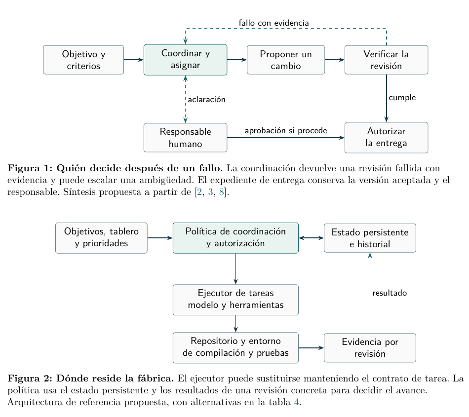
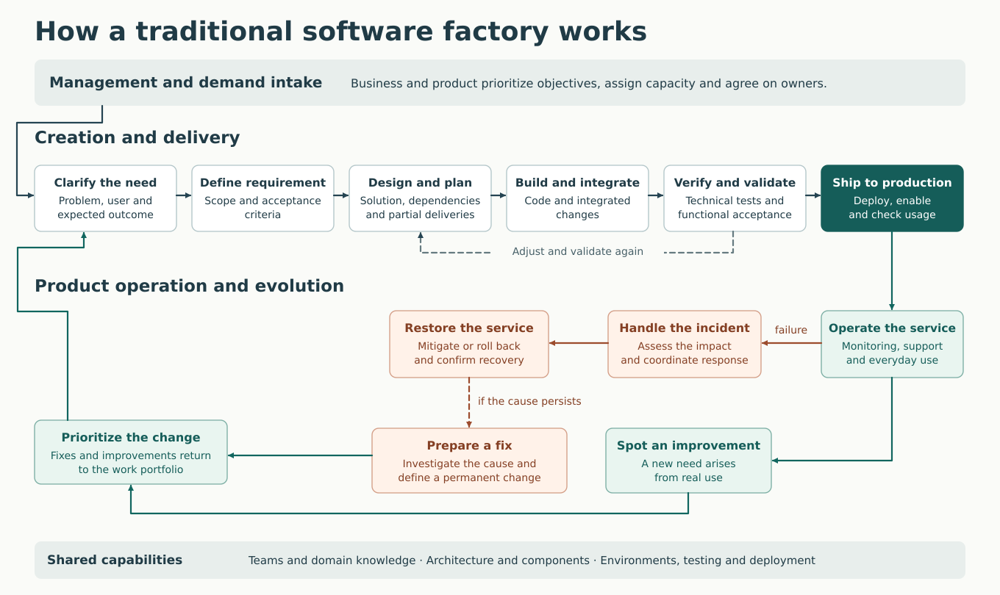
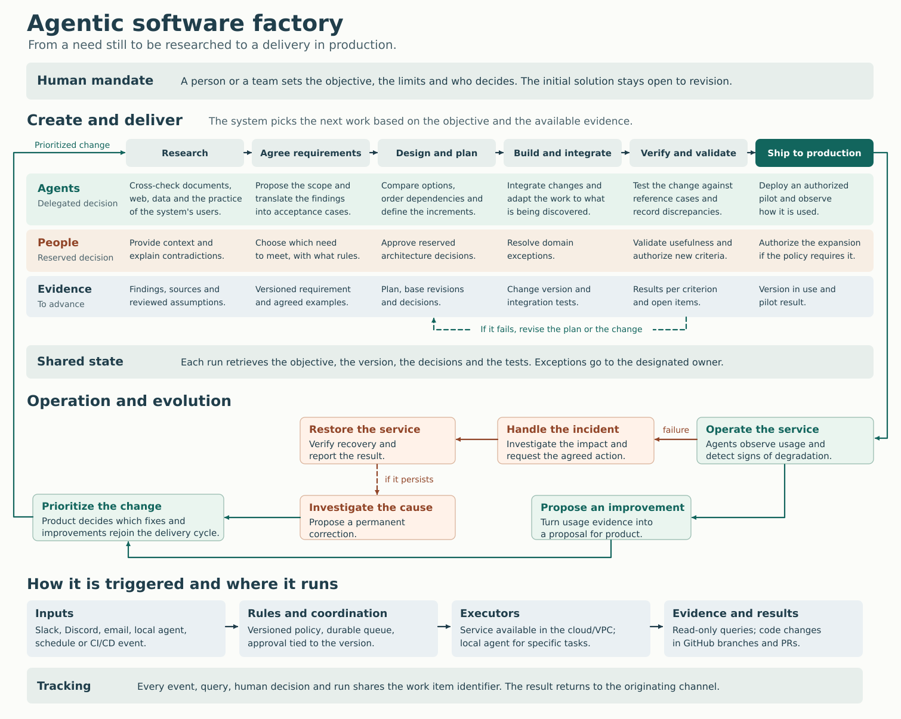

# Conversation: Agentic software factories (literature review, model, pilot)

> **Evidence.** Translated from Spanish on 2026-11-24. Original: OpenResearch chat "Fábricas de Software Agénticas" (Codex), 2026-11-21 to 2026-11-22, kept in the research workspace. Tool calls are omitted. Redactions are marked `[redacted: reason]`.

## 2026-11-21 22:39 · Diego

i want to start a literature review of an agentic software factoring. in the end an agentic software factory, which is different from a coding agent that assists a human

## 2026-11-21 22:39 · Assistant

I'm going to use the literature review and report guides to prepare a first annotated bibliography. I'll take as the central criterion who coordinates the work from the requirement to delivery and in which decisions a person steps in.

*(tool calls omitted)*

## 2026-11-21 22:39 · Assistant

I found two cases that help pin down the distinction. ChatDev starts with a requirement and coordinates the creation of the software. *Instant Software Factories* starts with an existing repository and studies who discovers, fixes and reviews the work that appears afterwards. The review covers both paths. [ChatDev](https://aclanthology.org/2024.acl-long.810/) · [Instant Software Factories, p. 1](https://www.alphaxiv.org/pdf/2610.36254?page=1)

*(tool calls omitted)*

## 2026-11-21 22:39 · Assistant

I started the review with six annotated works and a question that captures your distinction: **when a person hands over a goal, who decides what to do next and how do we know that the delivered software meets that goal?** [`artifacts/revision-bibliografica/fabrica-de-software-con-agentes.md`](../documents/2026-11-21-literature-review.md)

I propose using **agentic software factory** for a system that repeatably coordinates several stages, from a product or maintenance goal to a verifiable change. A person can clarify requirements or authorize a release. The distinction becomes visible when you follow a concrete decision. If a test fails, does the system send the problem back to the right agent, keep the context and verify the fix, or does a person have to organize those steps? This criterion also makes it possible to study factories that reuse the same agent across several runs. [Hua, p. 1](https://www.alphaxiv.org/pdf/2611.06946?page=1)

")

[Open the figure](../figures/2026-11-21-pavlenko-cycle.png)

Three readings locate the boundary:

- **Individual assistance.** In the experiment by Peng et al., a person is given the work item of implementing an HTTP server and can use Copilot. What is measured is how long they take to solve an already defined task. It is a clear comparator for the review. [Peng et al., pp. 1 to 2](https://www.alphaxiv.org/pdf/2302.06590?page=1)
- **Software creation.** In *ChatDev*, the user states a requirement and the agents divide design, programming and testing among themselves through structured conversations. It makes it possible to study what each role hands to the next and how far the system goes before returning the product to the user. [Qian et al., ACL 2024](https://aclanthology.org/2024.acl-long.810/)
- **Continuous maintenance.** *Instant Software Factories* starts where the prototype ends. In two installations observed for 15 and 17 days, the agents worked on existing repositories. In one of them, at least 5.6% of the issues marked as fixed had a solution that was later found to be incorrect. That figure shows why it is worth following each change beyond its closure. [Jiang and Lysenko, p. 1](https://www.alphaxiv.org/pdf/2610.36254?page=1)

The selection is exploratory. The question I propose to guide the review is **under what conditions a factory reduces the total human time per accepted change, also counting review, rework and later defects**. That way a factory can be compared with an assisted developer using the same goal and the same acceptance criterion.

## 2026-11-21 22:50 · Diego

i need a more polished, professional review, that distinguishes the agentic software factory model, that distinguishes the technologies to build them with, a polished paper-style review that ends with diagrams, tables, in a paper written in latex

## 2026-11-21 22:50 · Assistant

I'm going to expand the review and write it in LaTeX. I'll use the academic writing and figure guides so that the paper distinguishes three questions: what defines a factory, which technologies implement it and what evidence shows that it works. The manuscript will end with comparison tables and diagrams.

*(tool calls omitted)*

## 2026-11-21 22:50 · Assistant

The evidence shows why it is worth comparing operating models and technologies separately. In Agyn, a team of agents works until it produces a change proposal. In the industrial case by Pavlenko and colleagues, the output enters an engineering review queue. The manuscript will make explicit who receives the result and what is still missing for it to count as delivered in each case. [Agyn, §4](https://www.alphaxiv.org/pdf/2602.01465) · [Pavlenko et al., §4](https://www.alphaxiv.org/pdf/2609.36323)

*(tool calls omitted)*

## 2026-11-21 22:50 · Assistant

**Agentic software factories. Operating models, implementation technologies and delivery evidence** is available as a 10-page article and as editable LaTeX source. [`paper.pdf`](../documents/2026-11-21-paper-agentic-software-factories.tex) [`paper.tex`](../documents/2026-11-21-paper-agentic-software-factories.tex)

The article develops the distinction that motivated the review with a concrete question: **when a test fails, who decides what happens next?** In assisted development, the person may have to interpret the failure, reconstruct the context and formulate another work item. In a factory, the system keeps the goal, returns the evidence to the responsible party, verifies the fix and submits the delivery to the corresponding authority. Final approval can remain in human hands. [Hua](https://www.alphaxiv.org/pdf/2611.06946) · [Hassan et al.](https://www.alphaxiv.org/pdf/2611.21623)

The review proposes **four operating models** based on how the next piece of work is decided: procedures between roles, incremental planning, maintenance through a shared board and optimization guided by operational signals. For each one it identifies which state persists, who accepts the result and how far the published evidence goes. It then examines the technologies by function, from OpenHands for executing tasks to LangGraph or Temporal for preserving and resuming the process. It distinguishes the tools used in the studies from the documented alternatives for building an implementation. [`paper.tex`](../documents/2026-11-21-paper-agentic-software-factories.tex)

The manuscript brings together **22 references** and ends with **four comparison tables and two diagrams**. I adopted an integrative review with explicit source selection. The classification makes it possible to compare architectures and formulate hypotheses, although the available evidence does not allow declaring one model superior in every context. [`paper.pdf`](../documents/2026-11-21-paper-agentic-software-factories.tex)

[Enlarge the diagrams](../figures/2026-11-21-paper-diagrams.png)

## 2026-11-21 23:25 · Diego

there is progress, but it's poor, before writing the paper. we must determine what a software factory does, whether agentic or not. The failure is important, but for a failure to exist there has to be a software creation process. from the requirement to production. when the software is in prod the failures arrive, and solving those failures is another process of the software factory. without editing the paper, let's first see in the chat what the model of a traditional software factory would look like

## 2026-11-21 23:25 · Assistant

I'm going to start from the path a requirement follows until the software is in use, and from the different path that begins with an incident in production. I'll use the literature review guide to check the model against the literature and develop it here in the chat.

*(tool calls omitted)*

## 2026-11-21 23:25 · Assistant

My mistake was taking the response to a failure as the starting point. The first question is more basic: **how does an organization turn a need into software that someone can use in production?** Then comes another question: how does it sustain and modify that software once there are people who depend on it?

As a working definition, I propose that **a traditional software factory is an organization that turns requirements into software capabilities in production and that can repeat that process to create, maintain and evolve one or several products**. What gives it the character of a *factory* is that it keeps that capability from one delivery to the next: it knows who makes the decisions, how the specialties coordinate, which components are reused and what evidence allows a version to be released. This organizational dimension already appears in Cusumano's historical studies of software factories. [Cusumano, *The Software Factory Reconsidered*](https://hdl.handle.net/1721.1/11025)

### 1. The main process: from requirement to production

Let's take an example that we can follow all the way through. A chain of stores asks that **its store managers be able to download the day's sales to do the daily cash closing**.

| Stage | Main work and decision | Result in the example |
|---|---|---|
| **1. Understand the need** | Business, users and product clarify who has the problem, how they solve it today and what result they expect. | The store manager copies sales by hand. They need a file per store that they can reconcile with the cash register. |
| **2. Define and prioritize the requirement** | Product and business agree on scope, rules, acceptance criteria and priority relative to other requests. | The first version will export a store's sales and returns according to its business day. They agree on how the total must balance. |
| **3. Design the solution and plan the delivery** | Design and engineering decide what the experience will be like, which data are valid, which systems will change and how to split the work. | They define the download option, who can use it, where the total comes from and how to test it first in one store. |
| **4. Build and integrate** | Development implements the changes and integrates them with the existing product. | The interface requests the export, the service calculates the amounts and the system checks the store manager's permissions. |
| **5. Verify and validate** | Engineering checks the solution technically. Users or business owners check that it serves the intended work. | The tests cover sales, returns and the change of date. A store manager compares the file with a known closing. |
| **6. Release and check in production** | The responsible team deploys the version, enables the feature and observes its real behavior. | The pilot store does a closing with the new feature. With that evidence, they decide whether to expand availability. |

The rows represent **decisions the factory must resolve**. A team can go through them in small increments. If, while validating the file, it turns out that the business day ends at two in the morning, the work goes back to the definition of the requirement. That correction still belongs to the creation process. Release engineering connects the final part of the path, from an identifiable revision of the code to a reproducible deployment. [Google, *Release Engineering*](https://sre.google/sre-book/release-engineering/)

### 2. What happens once the product is in use

Production opens several processes with different triggers and closing conditions. Let's continue with the same store.

| Process | What starts it | When it meets its goal |
|---|---|---|
| **Day-to-day operation** | The feature is available and the store depends on it every day. | It is an ongoing responsibility: monitoring availability, response times and signs that the closings are being completed. |
| **Incident response** | At 20:00, the stores can no longer download the file. | Service is restored and it is confirmed that the affected stores can do their daily cash closing. Reverting the latest version may be enough to achieve this. |
| **Corrective maintenance** | Analysis reveals that a return with a certain format blocks the export. | The cause is fixed, a regression test is added and the new version is verified in production. |
| **Product evolution** | The store managers ask to split sales by payment method. The current feature is still operational. | The improvement goes back to the requirements process and ends when that new capability reaches its users. |

The distinction between **restoring** and **fixing** matters for the model. At 20:15 the store may have recovered the download thanks to a rollback. The incident can already be closed, even if the cause is still pending. Afterwards, the permanent fix goes through design, construction, testing and release. That is how two processes are connected without confusing their goals. [Google, *Managing Incidents*](https://sre.google/sre-book/managing-incidents/)

### 3. What makes all this a factory

The cycle above describes how **one** feature is delivered. To explain how **the organization** works, a layer is missing: while one store validates the export, another reports an incident and the business asks for an improvement. Someone must decide what work comes in, which work can interrupt the rest and how much capacity is reserved to sustain what is already in production.

That is why I would represent the traditional factory in three levels:

- **Direction and demand management.** Decides which products and changes to fund, in what order, with what capacity and who answers for the result.
- **Delivery and service processes.** Create features, operate the product, handle incidents and deliver fixes and improvements.
- **Shared capabilities.** Teams, domain knowledge, architecture, reusable components, environments, tests and deployment mechanisms let the second product or the next version take advantage of what was built before.

For our research, I would take **the requirement put into production** as the unit of creation, **the restored service** as the unit of incident response and **the change verified in production** as the unit of maintenance or evolution. That foundation makes it possible to study later which decisions the agents take on without losing sight of what the factory produces and to whom it answers.

## 2026-11-21 23:30 · Diego

ok now create a diagram of how a traditional software factory works

## 2026-11-21 23:30 · Assistant

I'm going to draw the path from the requirement to production and show what happens afterwards: daily operation, restoring the service after an incident and the return of fixes and improvements to the delivery cycle. I'll use the figures guide to leave the diagram in an editable format.

*(tool calls omitted)*

## 2026-11-21 23:30 · Assistant

[Open the diagram in editable SVG format](../figures/2026-11-21-traditional-software-factory.svg)

The diagram distinguishes **three results**. The creation process delivers a capability that the user can use in production. Handling an incident restores the service, for example, by reverting a version. If the cause persists, its fix goes back to the delivery cycle. An improvement requested by users enters that same cycle even if the service is working correctly.

## 2026-11-21 23:33 · Diego

perfect. now let's look into what an agentic software factory would look like. although humans still take part, what would have to be different?

## 2026-11-21 23:33 · Assistant

I'm going to use the literature review guide to contrast the traditional model with documented agentic factories. I'll pay attention to who decides the next step, what authority the person keeps and how far each system goes in production.

*(tool calls omitted)*

## 2026-11-21 23:33 · Assistant

In the traditional diagram, the first thing I would change is **who carries the requirement from one stage to the next**. The factory's goal is still to deliver useful software in production and to sustain it throughout its life. What makes the factory *agentic* is that people can **delegate an outcome** and that the system has the authority to organize the necessary work, check its progress and ask for a human decision when it reaches the limit of that delegation.

A traditional factory can already compile, run tests and deploy automatically. A team can also use assistants to draft requirements, design screens and write code. The difference shows up in a concrete question: **once the goal is approved, who has to turn it into the next work item?** If a person has to request the design, the implementation, the tests and the deployment one after another, that person is still coordinating the delivery. If the system can interpret the goal, choose the next piece of work based on what it discovers and carry it through to an acceptance decision, there is delegated coordination. This is the **working definition** I would propose for our research. [Hua, *Beyond the Agent Harness*](https://www.alphaxiv.org/pdf/2611.06946?page=1) · [Hassan et al., *The Software Engineering Factory*](https://www.alphaxiv.org/pdf/2611.21623?page=1)

#### How the path of the requirement would change

Let's go back to the store case. The work item is *"that the store manager can download the sales and reconcile the daily cash closing"*. This would be one possible distribution of responsibilities:

| Moment | What the agentic software factory takes on | Where the person takes part |
|---|---|---|
| **Understand and define** | It looks up how sales and returns are recorded, examines sample closings and proposes acceptance criteria. It detects that a sale at 00:30 could belong to two business days depending on the rule used. | The store manager explains how they do the real closing. Product decides which rule the system must follow and which result takes priority. |
| **Design and plan** | It examines the existing systems, proposes a solution, breaks down the work and orders the tasks according to their dependencies. It keeps the link between each task and the requirement that originated it. | Engineering steps in if the proposal involves a reserved decision, for example changing the official source of the accounting amounts. |
| **Build and integrate** | It prepares the changes in the interface and the service, integrates them in a test environment and adapts the plan if it discovers that a reusable component already exists. | Specialists can contribute directly, review a decision or take on a task that needs domain knowledge. |
| **Verify and accept** | It runs tests and compares the generated file with reference closings. It presents which criterion each result meets and which discrepancies remain open. | The store manager validates that the file works for the daily cash closing. Whoever answers for the product decides whether a discrepancy requires fixing the software or revising the requirement. |
| **Release and observe** | It prepares the version, runs the deployment within the agreed permissions and checks the result in the pilot store. | The person in charge can reserve the authorization to expand the deployment. The relevant evidence is that the store managed to reconcile its closing. |
| **Operate and evolve** | When there is an outage, it gathers signals and can apply a previously authorized mitigation. It opens the permanent fix separately. It can also propose improvements based on usage. | Operations leads the incidents that go beyond what was delegated. Business decides whether an improvement deserves to enter the portfolio and with what priority. |

The most valuable human participation in the example happens **before writing code**: someone must explain which day the 00:30 sale belongs to. It also happens **after deployment**: someone who knows the operation can confirm that the file really makes it possible to reconcile the cash register. Between those two moments, the system can coordinate a lot of work. The degree of autonomy can vary by process: an organization could broadly delegate construction and keep direct control over production.

#### What would have to exist for that to work

1. **A verifiable work item.** The system receives the goal, the constraints, acceptance examples and the decisions that require consultation. It can also detect that this information is incomplete.
2. **A shared state that survives each session.** The agreed requirement, the decisions, the code version, the tests and the deployment status are linked. Another person or another agent can pick up the work without reconstructing it from a conversation.
3. **Bounded authority to act.** It must be defined what the system can do on its own initiative, what requires approval and when it must stop. For example, it can deploy to a pilot store, but it needs authorization to extend the change to the whole chain.
4. **An acceptance that the executor itself cannot unilaterally redefine.** If the exported total does not match the reference closing, the system can investigate and propose a fix. Changing the expected amount requires justifying and approving a change of criterion.

The literature shows **parts** of this model with different scopes. ChatDev documents the segment that starts from a requirement and coordinates design, code and testing. *Instant Software Factories* studies the later end: agents that discover and handle work on existing repositories. In one of its cases, at least 25 of 450 issues marked as fixed contained an incorrect solution, which gives a concrete reason to verify the result independently of the closing of the task. Pavlenko and colleagues show a third segment: using operational signals to select optimizations and sending the resulting proposals to engineering review. They are complementary pieces of evidence; the full store path is our proposed synthesis. [ChatDev](https://aclanthology.org/2024.acl-long.810/) · [Instant Software Factories](https://www.alphaxiv.org/pdf/2610.36254) · [Towards an AI Software Factory for Data Systems](https://www.alphaxiv.org/pdf/2609.36323)

For the project's model, **I would keep the traditional diagram and add three indications to each stage: what the system can decide, what decision a person keeps and what evidence allows it to move forward**. That would make visible where real autonomy exists and would make it possible to compare two factories even if they use different technologies or numbers of agents.

## 2026-11-21 23:34 · Diego

make the diagram of the agentic software factory

## 2026-11-21 23:34 · Assistant

I'm going to create an editable diagram that follows the path of the traditional model. At each stage I'll show what the factory can decide, when a person steps in and what evidence allows it to move forward.

*(tool calls omitted)*

## 2026-11-21 23:34 · Assistant

[Open the editable SVG diagram](../figures/2026-11-21-agentic-software-factory.svg) · [Compare with the traditional factory](../figures/2026-11-21-traditional-software-factory.svg)

The central difference lies in **who decides the next step**. Once the goal and the limits are agreed, the factory can plan, build, verify and deploy within its mandate. If it discovers an ambiguous business rule, it consults the responsible person and resumes the work with that decision recorded.

## 2026-11-21 23:36 · Diego

ok let's document what we've theorized so far

## 2026-11-21 23:36 · Assistant

I'm going to gather what we've agreed in a working document in Spanish, with the two diagrams, the daily cash closing example and the questions that remain open. I'll save it as the project's conceptual foundation, separate from the article.

*(tool calls omitted)*

## 2026-11-21 23:36 · Assistant

I saved **From the traditional software factory to the agentic factory** as an editable working document. It includes the two diagrams and follows the daily cash closing example from the requirement to its use in production. [`artifacts/marco-conceptual-fabricas-de-software.md`](../documents/2026-11-21-conceptual-framework.md)

The document captures two central agreements. First, **creating software, restoring a service and delivering a fix are different processes**. Each has its own result and its own evidence of closure. Second, **what characterizes the agentic factory is the delegation of coordination between stages**. For each stage it identifies what the system can decide, what authority a person keeps and what evidence allows it to move forward.

The closing section distinguishes our working definition from the segments documented in the literature and sets out the questions for testing it.

## 2026-11-21 23:51 · Diego

ok let's continue with the agentic software factory model, now we have to double-click or rather go deeper.

first, something I find wrong with the model is that it doesn't have a research stage. since it's agentic it can use tools like web research or documents that the people themselves provide in order to do research. this step must come before agreeing on the requirements, good research can change requirements preconceived from experience or domain knowledge.

on the other hand, at the level of agent-person communication. a person communicates with their coding agent through prompts. the coding agent becomes a high-level assistant, since it can execute tasks on its own like claude code with models like opus 5.5 or codex with models like gpt sol 6.2, that is, if they run in agentic mode, however they still need the human prompt to be activated. under this premise certain instructions from the person should be programmed in ci/cd languages or common languages so that the agent can pick them up, or they get inserted through events. this is relevant so that the agent can be autonomous to some extent but have the human present through instructions they leave, for example, in a yml file.

the other thing, I think it's good that the person has to approve changes, usually they're teams of people, 2 or more, there's the case of a single person that must also be accounted for. this means the prompt or the events should be handled in the channels where the person or the team lives, slack, discord, email, coding agent.

the other thing, the coding agents must always be available, be able to have this system in the cloud, like a vpc, where coding agents that follow these rules are installed, like claude code, codex, open code, etc, and prompts can be injected through what we discussed above. this system should be monitored to see the performance of the agents and the interaction with humans. this system, although it has its own agents, should be able to connect to local coding agents for specific tasks, that's why one way of prompting mentioned before is the coding agent itself on the person's machine. this same system must connect in read-only mode to monitor logs, tools like sentry, posthog, really mcps, clis, and have the ability to create and run scripts to query dbs, etc, as well as being able to version code on github and have access to the repos, the repos in question and the vaults (which are also repos) must always be kept up to date here so that the coding agents can use tools like grep to search easily. ideally the agents that connect should be subscriptions to avoid the extra cost of the api.

for now that's what I'm missing, as we keep theorizing more things will occur to me.

## 2026-11-21 23:51 · Assistant

I'm going to incorporate these changes into the document and the diagram. I'll separate the creation cycle, which now starts with research, from the infrastructure that makes it possible to activate agents, consult evidence and ask for human decisions. I'll also check what conditions the providers document for using subscriptions with executors in the cloud.

*(tool calls omitted)*

## 2026-11-21 23:51 · Assistant

The previous model started too late. **The factory should receive a need or a hypothesis, research whether it is well formulated and only then agree on the requirement.** I incorporated that stage into the conceptual framework and the diagram. [`artifacts/marco-conceptual-fabricas-de-software.md`](../documents/2026-11-21-conceptual-framework.md)

In the daily cash closing case, someone might ask to "export sales by day". When checking that request against the shift manual, two real closings and a store manager's explanation, the agent could discover that the correct unit is **each store's shift**. The research deliverable would be concrete: what was asked, what evidence challenges the initial assumption, how the requirement would change and what decision product needs to make.

**The second change is to distinguish the autonomy to execute from the autonomy to start and resume work.** A coding agent can already solve a complex task from a prompt. The factory adds a persistent agreement: the person can leave in writing *"when a new closing arrives, check it against the current rule and bring me the discrepancies"*. The rule lives in YAML or in code, the received document generates the event and the coordinator prepares the work item. The person remains present through the instruction they left and the decisions they reserved for themselves.

That principle organizes the rest of the design:

- **Channels and approvals.** Slack, Discord, email and the local agent make it possible to open, clarify or approve the same work item. The approval stays tied to the proposal and version the person saw. In an individual project, whoever made the request can approve. In a team, each decision can have a different owner.
- **Cloud and local machine.** The factory remains available in a VPC to receive events and keep state. It can activate Claude Code, Codex or OpenCode when there is work. The local agent plays two roles: it is an entry gate for the person and an executor for tasks that need their environment.
- **Knowledge and permissions.** The factory syncs GitHub repositories and *vaults* to search with `grep` or `ripgrep`, and records the commit that supported each decision. Logs, Sentry, PostHog and databases are queried in read-only mode, even when the agent writes a script. Code changes follow the path of branch, tests and integration proposal.
- **Performance and cost.** Tracking distinguishes time in queue, execution and waiting for a human response. The preference is to use subscriptions when the plan allows the intended execution mode. I left the choice per provider open: interactive access and unattended automation may have different conditions. [Codex](https://developers.openai.com/codex/auth/) · [Claude Code](https://code.claude.com/docs/en/legal-and-compliance) · [OpenCode](https://opencode.ai/docs/providers/)

[Open the editable diagram](../figures/2026-11-21-agentic-factory-research-and-operation.svg)

One design question remains, and it can now be stated precisely: **what can an event trigger on its own?** In the example, receiving a document can authorize research and a revised proposal. Approving that proposal can authorize construction. Releasing to production requires the corresponding mandate. That distinction makes it possible to increase the factory's autonomy while keeping human control over the decisions that matter.

## 2026-11-22 00:16 · Diego

[redacted: internal woku path] something we can detail is the vaults, I think having documented the way it works, creating logs, plans, etc, noting bugs, how it solves them, how it verifies them, etc. I currently do this with woku but not as an agentic software factory, as a coding agent, but I think it can be really useful so that the agents in the vpc have somewhere to look up previous decisions, history, documentation, etc.

## 2026-11-22 00:16 · Diego (mid-turn)

and also have them take notes themselves as they go

## 2026-11-22 00:16 · Assistant

I'm going to review how you organize plans, logs and bugs in Woku. I'll use examples of that practice to detail in the conceptual framework what the agents in the VPC should consult, what they should write down themselves and how to distinguish an observation from an approved decision.

*(tool calls omitted)*

## 2026-11-22 00:16 · Diego (mid-turn)

the agent in the vpc should have access to various repos, both code and vaults

## 2026-11-22 00:16 · Assistant

In Woku I found a concrete example: QA recorded that two fixes were in a remote branch and left the functional verification pending. I'll incorporate that distinction and multi-repository access: a single work item may require code from several services, the engineering plan and the QA note. Woku verification log ([redacted: internal woku path])

*(tool calls omitted)*

## 2026-11-22 00:16 · Assistant

**The unit of work of the agent in the VPC is the work item.** To resolve it, the agent may need to read several code repositories and several vaults, and write to more than one. I incorporated this idea into the conceptual framework together with a second one: **the agent is also an author of the project's memory**. It updates the plan, notes decisions and failed attempts and leaves evidence of how it checked a fix. [`artifacts/marco-conceptual-fabricas-de-software.md`](../documents/2026-11-21-conceptual-framework.md) (lines 121 to 155)

Woku provides a concrete precedent. In a QA session, two fixes were found in a remote branch. The note recorded where they were and that their behavior was still pending testing. That distinction tells the next agent exactly what to do: retrieve the correct version and test it. Woku verification record ([redacted: internal woku path])

In the daily cash closing example, the handoff would work like this:

1. **At the start**, the agent consults the code of the service and the interface, searches the engineering vault for why it was decided to group by shift and retrieves the case of the 00:30 sale from the QA vault.
2. **While it works**, it updates the work item's log: what changed in each repository, which attempt it discarded and why. If there are two PRs, it links both and makes explicit that they must be tested together.
3. **When verifying**, the QA agent adds to the same entry the tested revisions, the environment, the observed result and any pending items. If it fails, the next turn already has a reproducible starting point.

The practical criterion I would set for this component is simple: **can another agent, local or in the VPC, pick up the work item tomorrow and know what was decided, what was attempted, what was verified and what is missing, without a person having to reconstruct the chat?**

## 2026-11-22 00:20 · Diego

ok now let's get practical, how would you go about building a system like this? which technologies would be used, terraform, something lower level like rust to implement terminals and ways to prompt the vpc agent, how would the connectors be built etc

## 2026-11-22 00:20 · Assistant

I'm going to bring the model down to a concrete architecture for a first pilot: how a work item travels from Slack to an agent in the VPC, how it writes to several repositories and how the evidence comes back for approval. I'll check the executors' official interfaces before deciding where a terminal is worthwhile and where a process without an interface is enough.

*(tool calls omitted)*

## 2026-11-22 00:20 · Assistant

I would build the first version with **Terraform for the infrastructure, TypeScript to coordinate the work items and Linux containers to run the agents**. I would reserve Rust for the desktop client if we need to control interactive terminals or distribute a local binary. To send a work item to an agent in the VPC we already have programmatic interfaces.

The first test would be concrete: **from Slack, ask the agent to investigate a cross-cutting Woku problem, read two code repositories and a vault, write its diagnosis in the vault and come back to the same thread to ask for a decision**. That tests the distinctive part of the factory before giving it permissions to modify code or deploy.

### Which technologies I would use

| Piece | Initial choice | What it does in the system |
|---|---|---|
| Infrastructure | **Terraform + AWS VPC + ECS Fargate** | Terraform defines network, identities, services and storage. A small service is always available to receive work items. Each agent run gets its own container. [Terraform](https://developer.hashicorp.com/terraform/intro) · [Fargate](https://docs.aws.amazon.com/AmazonECS/latest/developerguide/AWS_Fargate.html) |
| Coordinator | **TypeScript + Node.js + Fastify** | Interprets the project's YAML rules, identifies who can approve, chooses the executor and returns the result to the originating channel. |
| State and queue | **PostgreSQL + pg-boss** | Keeps work items, events, attempts and approvals. If the agent asks for a decision on Friday, its container can terminate and the work can resume on Monday. [pg-boss](https://github.com/timgit/pg-boss) |
| Workspace | **Git + GitHub App + ripgrep** | Prepares the authorized code repositories and the vaults together. Records which commit it read from each one. The agent can write the diagnosis and propose it in a branch of the vault. [GitHub Apps](https://docs.github.com/en/apps/creating-github-apps/authenticating-with-a-github-app/generating-an-installation-access-token-for-a-github-app) |
| Observability | **OpenTelemetry + CloudWatch** | One identifier follows the whole path. It makes it possible to distinguish how much time the agent consumed, how much was spent waiting for infrastructure and how much was spent waiting for a human decision. [OpenTelemetry](https://opentelemetry.io/docs/concepts/signals/traces/) |

#### How I would send prompts to the VPC agent

The VPC agent would be **a process to which the coordinator hands a structured work item**. For example, the Slack event identifies the thread and the project. The versioned policy establishes that this stage allows reading [woku's service repository], [another woku repository] and [woku's engineering vault], and writing a proposal in the vault. The coordinator combines both with the work item's history and builds the prompt.

For Codex, the Node executor can launch `codex exec --json -` and write the prompt through `stdin`. Claude Code offers programmatic execution through `claude -p` and its SDK. OpenCode offers JSON events from its CLI and a server API. Each adapter translates those differences into the same factory contract: **start, receive events, deliver results and cancel or continue**. The effective permission is enforced by the process's credentials and environment. [Codex](https://developers.openai.com/codex/noninteractive/) · [Claude Code](https://code.claude.com/docs/en/headless) · [OpenCode](https://opencode.ai/docs/server/)

**Rust comes in when a person needs to take interactive control of a session.** There I would use a local client with Tokio and `portable-pty`, and `xterm.js` if we want to show the terminal in the browser. For the most frequent case ("find out how this bug was solved and reply to me in this thread"), the work item protocol is enough. [portable-pty](https://docs.rs/portable-pty/) · [xterm.js](https://xtermjs.org/)

#### How I would build the connectors

I would separate three interfaces because they have different permissions and responsibilities:

- **Communication channels.** Slack, Discord, email and the local agent translate their messages into a common event with project, actor, thread and external identifier. I would start with **Slack Bolt and Socket Mode**: the connection goes out from the VPC. The connector also knows how to reply in the thread and tie an approval to the exact version of the diagnosis. [Slack Socket Mode](https://docs.slack.dev/apis/events-api/using-socket-mode/)
- **Query tools.** Sentry, PostHog, logs and databases expose read operations. They can be implemented with an SDK, CLI or MCP. I would start with **a query the team already uses to verify a real bug**. If the agent needs to write a script to cross-reference results, the script inherits the same read-only identity.
- **Local agent.** I would give it two modes. As a **channel**, a small MCP server lets the person create a work item in the cloud, provide context and check its status from their coding agent. As an **executor**, a local client can pick up a task that requires a specific development environment and return its evidence to the same dossier. That way, working locally and continuing in the VPC are two steps of the same work item.

The design decision I would make from day one is **to keep the work item's state outside the agent's session**. PostgreSQL keeps what must happen and who authorized it. Git and the vaults keep what was researched, what changed and how it was verified. Thanks to that, you can switch from Codex to Claude Code, restart a container or hand the work over to a person without losing the thread.

I left the architecture, the implementation path and the acceptance tests in a document. The first version can be tested with Docker Compose; after that, the same path is deployed on AWS. The choice between subscription and API remains to be validated for each unattended executor before committing to costs. [`artifacts/arquitectura-piloto.md`](../documents/2026-11-22-pilot-architecture.md)

## 2026-11-22 00:24 · Diego

let's think about this architecture so that it works for any project

## 2026-11-22 00:24 · Assistant

I'm going to review which parts of the pilot ended up coupled to Woku, AWS or Slack and define what a new project would have to declare to use the factory. I'll test it against two different projects, including one with no prior repository and no production.

*(tool calls omitted)*

## 2026-11-22 00:24 · Diego (mid-turn)

now let's go with single-project. later, once we manage to polish the software factory well, we'll go for multi-project

## 2026-11-22 00:24 · Assistant

I'm going to adjust the pilot for a single factory dedicated to one project. I'll keep access to several repositories and vaults of the same product, and leave the multi-project design as a future reference.

*(tool calls omitted)*

## 2026-11-22 00:24 · Assistant

The pilot is now **single-project and multi-repository**. One installation serves a single product and its team. The agent can work on the service, the interface and the engineering and QA vaults with a single configuration of resources, permissions and approvers. I updated the architecture with that scope. [`artifacts/arquitectura-piloto.md`](../documents/2026-11-22-pilot-architecture.md)

I proposed **Woku as the first test case**. The path starts with a concrete issue: the agent investigates in code and vaults, documents the diagnosis and asks for approval. Then it implements the change, runs the regression test and records in the log which version it verified, in which environment and what remained pending. [`artifacts/arquitectura-piloto.md`](../documents/2026-11-22-pilot-architecture.md) (lines 48 to 56)

The criterion for moving to multi-project will be practical: **that the team can repeat the cycle with another Woku work item and that a new agent can pick it up from the vault without a person reconstructing the conversation**. Until then, the multi-project design remains a future reference. [`artifacts/arquitectura-multiproyecto.md`](../documents/2026-11-22-multi-project-architecture.md) (lines 1 to 3)

## 2026-11-22 00:26 · Diego

leave everything documented

## 2026-11-22 00:26 · Assistant

I'm going to review the existing documents and diagrams and leave an entry guide that connects the model, the architecture decisions and the single-project pilot. I'll also make explicit what is agreed, what is still a proposal and how it would be tested in Woku.

*(tool calls omitted)*

## 2026-11-22 00:26 · Assistant

The documentation is now gathered in an **entry guide** that links the conceptual framework, the diagrams, the literature review, the LaTeX article and the pilot architecture. I verified its local links. [`README.md`](../documents/2026-11-22-research-guide.md)

The current scope is **one factory for one project, with access to several code repositories and several vaults**. The framework explains what the agents research before agreeing on requirements, what decisions the person keeps and what the agents must write so that another one can pick up the work item. [`docs/marco-conceptual-fabricas-de-software.md`](../documents/2026-11-21-conceptual-framework.md)

The architecture includes the proposed technologies, the connectors, the permissions and the acceptance tests. **The pilot is still in design.** Woku is the first proposed case for testing the path from a request to a verified delivery and repeating it with a second work item before resuming the multi-project design. [`docs/arquitectura-piloto.md`](../documents/2026-11-22-pilot-architecture.md)

## 2026-11-22 11:01 · Diego

the pilot architecture doesn't mention chrome or something similar, whatever is best for doing visual ux/ui frontend checks

## 2026-11-22 11:01 · Assistant

I'm going to incorporate visual verification into the pilot. I'll check what Woku uses and what each tool contributes to testing an interface, comparing screenshots and leaving evidence that a person can review.

*(tool calls omitted)*

## 2026-11-22 11:01 · Assistant

I incorporated **Playwright Test with Chromium** as the pilot's visual verification component. I chose it because Woku already has QA walkthroughs on staging with that browser, screenshots, video and traces. To reproduce a problem specific to Google Chrome, Playwright also makes it possible to run the same case with installed Chrome. [`docs/arquitectura-piloto.md`](../documents/2026-11-22-pilot-architecture.md) (lines 30 to 42) [Supported browsers](https://playwright.dev/docs/browsers)

The design distinguishes three checks:

- **Functional.** The agent goes through a task in a real browser and checks the result. For example, it chooses a period, clicks "Export" and verifies that it gets the expected file.
- **Visual.** It compares the screen with an approved screenshot on desktop and mobile. If a fixed bar covers the button on mobile, it attaches the screenshot, the visual diff and the trace to the QA entry.
- **User experience.** The agent checks keyboard navigation, focus and error states. When the question is whether a person understands what to export or recognizes that the operation has finished, UX or QA reviews the flow and records their decision. [`docs/arquitectura-piloto.md`](../documents/2026-11-22-pilot-architecture.md) (lines 34 to 42)

The architecture already describes when the check is triggered and what evidence goes back to the vault. Running it on a Woku release candidate remains pending as a pilot test.

## 2026-11-22 11:05 · Diego

the other thing that needs to be incorporated is a context check, and when it's over 50% a compact should be done, they're similar commands across various coding agents

## 2026-11-22 11:05 · Assistant

I'm going to incorporate the 50% threshold into the pilot's executor and check how each agent exposes context usage and compaction. I'll also define how the work item continues when the provider doesn't offer that operation in automatic mode.

*(tool calls omitted)*

## 2026-11-22 11:05 · Assistant

I incorporated the rule into the pilot: **when a session goes over 50% of its context window, the executor saves its progress and requests a compaction before the next step**. At exactly 50% it continues. The same policy applies to the local agent and to the VPC agent. [`docs/arquitectura-piloto.md`](../documents/2026-11-22-pilot-architecture.md) (lines 52 to 56)

Each adapter uses its provider's mechanism. Before compacting, it preserves the goal, the human decisions, the repository revisions, the evidence and the next pending action. That way the agent can resume the work item without repeating work or losing an approval. [`docs/arquitectura-piloto.md`](../documents/2026-11-22-pilot-architecture.md) (lines 56 to 64)

The rule is **documented and pending validation** with Codex, Claude Code and OpenCode in unattended mode. The proposed test uses a 100,000-token window: at 50,000 it continues, at 50,001 it compacts and, if it receives the same event twice, it runs a single compaction. [`docs/arquitectura-piloto.md`](../documents/2026-11-22-pilot-architecture.md) (line 66)

## 2026-11-22 11:10 · Diego

use the impeccable skills and make a landing page to explain the idea. you must be very careful in how you explain it, the idea is that anyone can understand it. the design must be very visual, lots of diagrams, but they should be attractive

## 2026-11-22 11:10 · Assistant

I'm going to use Impeccable to design the landing page and Sites to prepare the delivery. The common thread will be an everyday request: how it goes from a conversation to an improvement that someone can use, what the agents do and at which moments a person decides.

*(tool calls omitted)*

## 2026-11-22 11:10 · Assistant

*Question with options:* To present the idea to someone who has never used an agent, which example would you prefer to follow in the diagrams?

- The daily cash closing of a store
- How to solve a problem in an application

*Diego's answer (note):* create a support agent for the software

*(tool calls omitted)*

## 2026-11-22 11:10 · Diego (mid-turn)

In response to: To present the idea to someone who has never used an agent, which example would you prefer to follow in the diagrams?

create a support agent for the software

## 2026-11-22 11:10 · Assistant

I'll use the example you chose. The page will follow two different things: the factory that researches, builds and tests, and the support agent that the person receives at the end. A demo will make it possible to see how that agent responds when it finds a guide and when it refers the query to the team.

*(tool calls omitted)*

## 2026-11-22 11:10 · Assistant

**Open the interactive landing page** [redacted: private link] · Private access.

The page follows one example from start to finish: **creating a support assistant**. Five interactive diagrams show how a need is researched, how what to solve is agreed on, and how the assistant is built, tested and delivered. A simulation makes it possible to see when it responds with a guide and when it refers the query to a person. `landing/dist/index.html` (not included in the evidence)

I verified the walkthrough and the simulation on desktop and mobile. I also left an **HTML version that works offline**. `artifacts/guia-visual-agente-de-soporte.html` (not included in the evidence)

Cover of the visual guide on creating a support assistant (not included in the evidence)

Enlarge the cover (not included in the evidence)

## 2026-11-22 11:24 · Diego

make another version, more tech, like for the CTO, with concepts in English like agentic software factory, and explaining what they would have to configure and so on. and more tech dev colors

## 2026-11-22 11:24 · Assistant

I'll create a second landing page for CTOs. I'll keep the support agent example, but this time the walkthrough will show the architecture, the permissions, the configuration manifest and the evidence I would ask for before approving the pilot. I'll use Impeccable and Sites to give it its own visual identity.

## 2026-11-22 11:24 · Diego (mid-turn)

keep the previous one

## 2026-11-22 11:24 · Diego (mid-turn)

right, a second one

*(tool calls omitted)*

## 2026-11-22 11:24 · Assistant

The CTO edition now lets you inspect the five stages, change the channel, the runtime and the executor, download the resulting YAML and simulate an approval. I tested those interactions on desktop and mobile, and checked that the files of the first landing page keep their original content.

*(tool calls omitted)*

## 2026-11-22 11:24 · Assistant

**Open Agentic Software Factory · CTO Edition** [redacted: private link] · Private, standalone site. The introductory landing page ([redacted: private link]) stays at its original address.

The CTO edition follows the support agent case from the architecture side. It lets you **explore the control plane**, choose channel, runtime and executor, download a **sample YAML manifest** and simulate the approval of a version. It also explains what to configure in repositories, vaults, permissions, budget and observability.

I tested the configurator, the download and both approval paths on desktop and mobile. I also left a version that works offline. `artifacts/agentic-software-factory-cto.html` (not included in the evidence)

Cover of Agentic Software Factory, CTO edition (not included in the evidence)

Enlarge cover (not included in the evidence)

## 2026-11-22 19:44 · Diego

research this https://www.warp.dev/factories and let's see if the way we generate the prototype and the pilot architecture can be adapted https://docs.warp.dev/factories

## 2026-11-22 19:44 · Assistant

I'm going to compare Warp's two pages and its technical documentation with the current pilot. I'm interested in identifying what we could test sooner, which pieces we could reuse and which would remain our responsibility.

*(tool calls omitted)*

## 2026-11-22 19:44 · Assistant

I found two differences that change the decision for Woku. Warp lets you version stages and approvals in a *Blueprint*, and its option to run in a VPC keeps the control plane in Warp and requires Enterprise. I'm going to leave a sample Blueprint and compare what we could validate locally before choosing a provider. [Blueprints](https://docs.warp.dev/factories/blueprints/) · [Self-hosting](https://docs.warp.dev/factories/self-hosting/)

*(tool calls omitted)*

## 2026-11-22 19:44 · Assistant

Yes. **I would adapt the way we generate the prototype before deciding whether we adopt Warp as a platform.** The main change is one of order: first show that the factory can take a real work item from research to verification; then choose how much of the coordinator, the connectors and the VPC is worth building. Warp offers a concrete mechanism for doing this: a versioned *Blueprint* that declares stages, owners, conditions for moving forward and approval points. [Warp Factories](https://www.warp.dev/factories) · [Blueprints documentation](https://docs.warp.dev/factories/blueprints/)

#### How the first prototype would change

I would take the **support agent** as the test product. I would give the factory a current guide, an outdated one and two queries: "I forgot my password" and "I have a duplicate charge". That way we can check whether it researches before building, whether it knows when to ask for a decision and whether it delivers something another person can verify.

| Stage | What the pilot must show |
|---|---|
| **Research** | The *foreman*, the coordinating agent, detects the contradiction between guides, cites the revisions it consulted and leaves the diagnosis in the vault. |
| **Agree** | Product reviews a concrete specification. If product asks for changes, the factory comes back with a new version. Implementation only starts when that version is approved. |
| **Build** | A *builder* prepares the change in a branch and links code, specification and log. |
| **Verify** | An independent *verifier* checks that the assistant answers questions about access with the correct guide and refers the charge to support. If there is an interface, Playwright and Chromium provide evidence of the flow on staging. |
| **Deliver** | The team receives the commits, the result per criterion and the pending items. A second session must be able to pick up the work item from the vaults. |

The first test I would run is **to ask for a change to the plan when the factory requests approval**. That reveals whether it keeps the work item, updates the specification and waits for the right decision. A run in which everything is approved on the first try barely exercises the coordination we want to build. Warp documents exactly this rehearsal on a versioned specification. [Gates](https://docs.warp.dev/factories/blueprints/gates/) · [Testing and tuning](https://docs.warp.dev/factories/guides/testing-and-tuning-your-factory/)

#### What I would take from Warp and where I would keep our own control

- **I would adopt the Blueprint and case-based evaluation right away.** We can rehearse the flow with a local executor and Git before deploying Slack, PostgreSQL and ECS. Warp's *benchmarks* compare configurations of one worker on fixed tasks. To evaluate our full factory I would also measure human minutes, rework and cost per accepted delivery. [Benchmarks](https://docs.warp.dev/factories/benchmarks/) · [Warp metrics](https://docs.warp.dev/factories/measure-and-improve/)
- **I would try Factory MCP before developing the local client in Rust.** Warp documents the path we were looking for: sending a work item from a local agent, picking it up on a person's machine and returning the result to the same job. That handoff is a direct test of whether we need our own client. [Factory MCP](https://docs.warp.dev/factories/factory-mcp/)
- **I would make managed adoption conditional on three checks.** *Self-hosting* requires Enterprise and keeps the control plane in Warp. For managed Codex, Warp documents a funded API key, which affects our preference for subscriptions. And it remains to be shown that the chosen harness lets us apply and confirm our compaction when usage goes over 50%. These are conditions capable of changing the decision for Woku. [Self-hosting](https://docs.warp.dev/factories/self-hosting/) · [Harness authentication](https://docs.warp.dev/factories/harnesses/authentication/)

**I captured the adaptation in the architecture and prepared a five-stage Blueprint with three workers.** I validated the YAML and the worker definitions locally against the public `v1alpha1` schema, and also checked the references and the reachability of the stages. The repositories in the example are fictitious. The run in Warp and the test with Woku are still pending. [`prototipos/warp/factory.yaml`](../prototypes/warp/factory.yaml) [`docs/warp-factories-y-piloto.md`](../documents/2026-11-22-warp-factories-and-pilot.md) [`docs/arquitectura-piloto.md`](../documents/2026-11-22-pilot-architecture.md) (lines 7 to 11)
