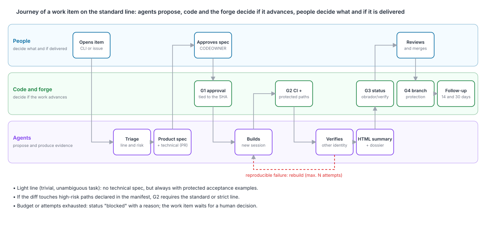
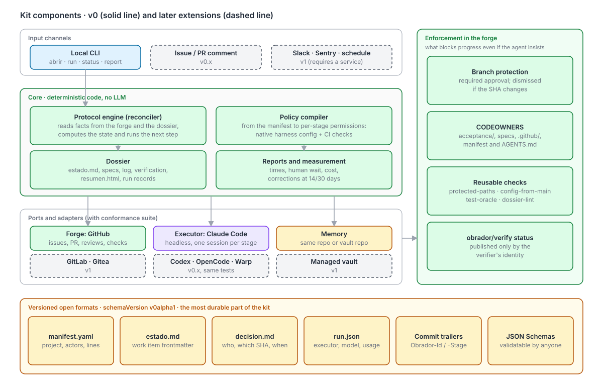

# Conversation: Critical review, public kit, license and name

> **Evidence.** Translated from Spanish on 2026-11-24. Original: OpenResearch chat "Revisión Crítica Fábrica Software" (Claude Code), 2026-11-22, kept in the research workspace. Tool calls are omitted. Redactions are marked `[redacted: reason]`.

## 2026-11-22 20:38 · Diego

I need us to do a critical review of this initiative and also of these transcripts of talks from the AI engineer youtube channel ai-engineer-youtube/ and also search the literature again to polish and back up version zero of our software factory

*(tool calls omitted)*

## 2026-11-22 20:38 · Assistant

I'm reading the initiative (conceptual framework, pilot, Warp) and now the five transcripts; after that I'll do the literature search.

*(tool calls omitted)*

## 2026-11-22 20:38 · Assistant

I've read the initiative and the five talks. Now I'm loading the literature review and report guides for the search.

*(tool calls omitted)*

## 2026-11-22 20:38 · Assistant

I'm still reading the key papers (14 of 20 so far); then I'll write the critical report.

*(tool calls omitted)*

## 2026-11-22 20:38 · Assistant

I have enough evidence. Before writing, I'm extracting an original figure (CompAct-Bench) that supports the critique of the compaction policy.

*(tool calls omitted)*

## 2026-11-22 20:38 · Assistant

I have the pages for the citations. I'm now writing the report in the artifacts directory.

*(tool calls omitted)*

## 2026-11-22 20:38 · Assistant

I did the critical review of the initiative, read the five talks and reviewed about 20 recent papers. The report is at [2026-11-22-critical-review-and-version-zero.md](../documents/2026-11-22-critical-review-and-version-zero.md).

**Verdict.** The conceptual framework holds up well against the 2026 literature: delegating by process and by decision, acceptance independent of the executor, the vault as memory for the handoff, and measuring per accepted change. The problem is the order in which it is being built. The architecture documents mostly detail the orchestration: VPC, queues, three providers, compaction at 50%, Rust and multi-project. On the other hand, they say almost nothing about two things that the evidence and the five talks put first: automated controls in Woku's own code, and verification that the builder agent cannot alter.

**Main findings:**
- **The prototype's gates are written in prose.** In [factory.yaml](../prototypes/warp/factory.yaml) the move to building depends on a sentence that a model evaluates ("the person explicitly approves…"). That contradicts what the pilot itself says. Instructions written in AGENTS.md are followed 59.8% of the time on average, and some are always followed while others never are. Proposal: make the approval a GitHub approval tied to the exact commit.
- **The "independent acceptance" condition has no mechanism at all.** 80.2% of the tests that agents write have no assertions or only weak ones. In addition, frontier models search the git history for hidden tests in order to pass the tests. Proposal: acceptance tests in a protected path, a check that blocks changes to that path, to the CI and to the lint, and a verifier with a different identity.
- **Merge rate and "autonomy" are misleading as metrics.** Agent PRs that have already been merged need later fixes with 1.62 times the odds of human PRs. In addition, 64% of rejections are not due to agent failures. We need to measure fixes at 14 and 30 days, and human minutes per accepted change.
- **The 50% compaction rule has no backing.** Compacting the context loses information, and there is no fixed threshold that works for everything. What really helps is having the state saved (decisions, discarded alternatives, next step). Proposal: a new session per stage that starts from the vault.
- **Security: prompt injection is not addressed.** Malicious content in unmerged PRs or in the repository ends up working as operator instructions. In one study, the agent got overly broad permission rules approved in 58% of cases. Proposal: read the agents' configuration only from `main` and do not let agents create persistent permissions.

")

**About the talks.** Tan and Ronacher agree: don't automate a loop that isn't reliable yet, and human attention is what limits the pace. Lloyd contributes the idea of defining the factory in code and measuring it, but he sells Warp Factories. He himself says the platform is overkill for teams of fewer than about 10 people. Our documents adopted almost all of Lloyd's part and almost none of Tan's.

**Proposed version zero (§4 of the report):**
- **Workshop first:** turn the corrections that keep recurring in Woku into 5 to 10 lint or architecture rules, and prepare a feature map for the verifier.
- **Minimal line:** CLI, GitHub as the state record, the vault as the dossier, a single agent and two human decisions (the spec and the delivery), each with an HTML summary.
- **Measurement:** compare against the current mode (person + agent) on 10 to 15 real work items, assigned in alternation. Times must come from records, not from self-reporting: in the METR study developers were 19% slower with AI and believed they had been 20% faster.
- **Moved to v1, with explicit entry criteria:** VPC, Slack, the Postgres queue, the second provider, unsupervised self-improvement and multi-project.

**Limits of the evidence.** Almost everything is 2025 to 2026 preprints, and the repository studies use open source data. The paper on PR self-merging has a single author, and I used it only as a signal that corroborates another study.

**Decisions that are yours to make:**
- Do you accept scaling v0 down to CLI + GitHub + vault?
- Which agent is authorized to run unsupervised on the machine of whoever launches it?
- Who is responsible for `acceptance/` and for the product specs?
- Which work items go into the comparison?

If you want to share it with the team, I can publish it as a page.

## 2026-11-22 20:49 · Diego

understand that although i want to use it at woku, i want to leave a public repo so that more people or other companies can build their software factory. does that make sense?

## 2026-11-22 20:49 · Assistant

It makes sense. I'm adjusting the report to reflect that the goal is a public kit, with Woku as its first installation.

*(tool calls omitted)*

## 2026-11-22 20:49 · Assistant

Yes, it makes sense: the goal is a **public kit** so that anyone can set up their own factory, and Woku is the first installation and the reference case. This doesn't change the recommendation of a minimal v0; it makes it more necessary. I added a section 5 to the report, [2026-11-22-critical-review-and-version-zero.md](../documents/2026-11-22-critical-review-and-version-zero.md).

**What changes:**
- **Every mandatory piece of infrastructure is a barrier to adoption.** A kit that only asks for GitHub, a CLI agent and Markdown can be tried in an afternoon. One that requires Terraform, AWS, RDS and Fargate leaves out almost every small team. The VPC becomes an optional deployment profile, not the default path.
- **The public has to be separated from the private.** The public repo carries the versioned formats (spec, dossier, decision record), the runner with its adapter contract, the reusable CI checks, the manifest schema and the measurement protocol. The Woku installation keeps its own vaults, repos, people, credentials and lint rules.
- **What lasts is the formats, not the tool.** The kit must work the same with Claude Code, Codex, OpenCode or Warp. This is Ronacher's idea about shared standards.
- **That it works outside Woku has to be demonstrated.** v0 includes an example repo inside the kit (the support agent case that is already designed), so that anyone can reproduce the full journey without access to Woku.
- **The default configuration has to be secure.** Whoever adopts it will run it with their own credentials, so the defenses against prompt injection must come enabled and explained in a `SECURITY.md`. If the repo itself is maintained with its own factory, PRs from outside contributors must not be able to trigger agents with credentials without a label set by the project maintainer.
- **Measurement may be what sets you apart.** Almost everything published about factories is figures from the teams themselves or from vendors. An open protocol to compare "factory" against "person + agent" on the same work items is useful to any adopter.

***Before publishing anything, the internal Woku references have to be cleaned up.*** The conceptual framework cites paths and commits from the engineering vault and the QA vault, and the pilot cites [redacted: internal woku reference].

I added three new decisions:
- Which license? Apache-2.0 includes an explicit patent grant; MIT is simpler.
- What will it be called, and who maintains it?
- What from Woku can be published as a reference case: only aggregate metrics, or anonymized dossiers too?

I also saved to memory that the goal is the public kit, so it's taken into account in future sessions.

## 2026-11-22 21:02 · Diego

perfect, so generate a model and architecture according to this new direction

- regarding the license, what do you recommend?
- i maintain it, Diego Orrego, my github is diorrego, i don't know the name
- i don't know yet

## 2026-11-22 21:02 · Assistant

First I'll check whether the candidate names are free on npm and GitHub, so the name recommendation isn't left up in the air.

*(tool calls omitted)*

## 2026-11-22 21:02 · Assistant

Now I'm generating the two diagrams (components, and the journey of a work item) and checking them visually.

*(tool calls omitted)*

## 2026-11-22 21:02 · Assistant

The diagrams look good. I'm writing the model and architecture document.

*(tool calls omitted)*

## 2026-11-22 21:02 · Assistant

I generated the model and architecture of the public kit. Woku remains the first installation, and v0 works with no server and no cloud: just GitHub, an agent CLI and Markdown. The document is [2026-11-22-public-kit-model-and-architecture.md](../documents/2026-11-22-public-kit-model-and-architecture.md).

**Main architecture decisions:**
- **No database in v0.** The engine just looks at GitHub and the dossier, decides the next step and executes it. Repeating it duplicates nothing, because branches have fixed names, PRs carry a marker and commits carry traceability tags. `watch` repeats it every few minutes, and that is enough as a "permanent factory".
- **Gates are not decided by a model.** GitHub enforces them:
  - the spec approval is tied to that commit and is dismissed if a new one arrives;
  - there are checks that block changes to `acceptance/`, to the CI, to the manifest and to AGENTS.md;
  - verification only counts if it is posted by the verifier's identity.
- **Double permission control.** Each stage receives the agent's native configuration (prevention), and in addition a CI check reviews the result (checking).
- **Interchangeable adapters.** Each agent connects through a minimal TypeScript contract, and an adapter is only published if it passes a test suite. That way others will be able to add Codex, OpenCode or Warp, and compare agents with the same tests.
- **Versioned open formats** (`obrador/v0alpha1`), with field names in English to make international adoption easier.
- **The repo includes an example project** (the support agent that was already designed), so that anyone can try the full journey without access to Woku. Woku's manifest stays private.

**License: I recommend Apache-2.0**, with contributions under the DCO (`Signed-off-by`) instead of a CLA:
- It is permissive, which is what you want so that other companies adopt it.
- Unlike MIT, it includes an explicit patent grant, something a company's legal team usually reviews before adopting a project.
- It doesn't grant the trademark, so the name remains yours.

I ruled out AGPL and BSL because they hold back precisely those companies. This isn't legal advice: if Woku contributes its own code, first confirm who holds the copyright.

**Name: I recommend "obrador"** (the workshop where things are made by hand). It connects with Ronacher's idea of building the workshop before the factory, and it is free on npm. There is already an "obrador" user on GitHub, so the repo would be `diorrego/obrador`. I checked other options:
- **"telar"** (the Jacquard loom, the first programmable machine) is taken on npm and would have to be published with a prefix, like `@diorrego/telar`.
- **"relevo"** is best ruled out: there is an active npm package that does almost the same thing.

On what to publish from Woku: I left it as pending, and v0 doesn't depend on that decision.

What's left for you is to confirm the name and the license, and to choose the verifier's identity at Woku (I recommend a GitHub App). With that I can start putting together the repo skeleton: schemas, CLI and the four checks.

## 2026-11-22 21:54 · Diego

isn't atelier a good fit?

*(tool calls omitted)*

## 2026-11-22 21:54 · Assistant

Yes: as a concept, "atelier" fits perfectly. It's Ronacher's exact word ("the atelier or workshop") and it sums up the thesis of the review well: first the workshop, then the factory. But as the name of a public repo it clashes with projects that already exist. I checked today:

- **It's taken on npm.** The `atelier` package is a build tool from 2022, and `atelier-cli` is also taken.
- **It clashes with a project that does almost the same thing.** `martinffx/atelier` describes itself as "An atelier for your Agent: spec-driven workflows, deep thinking, and code quality". It's a direct competitor with the same name.
- **It's already associated with Ronacher's ecosystem.** `pi-atelier` (388 stars) is an extension of Earendil's Pi agent. An "atelier" for agents would read as part of Pi, or as something borrowed from his talk.
- **There's a lot of noise.** GitHub has about 33,000 repos with "atelier" in the name, so it would be hard to find. Also, "Atelier" is a well-known video game series. I didn't verify that last one as a registered trademark; I mention it only as a risk of confusion.

That's why I'm keeping the recommendation of **"obrador"**, which is basically the translation of atelier: the workshop where things are made by hand. It keeps the meaning, it's free on npm and it has no direct competitor. The README can explain the connection: *obrador (es.) ≈ atelier, workshop*.

If you prefer a name in English or French, we can look for a compound variant. Tell me and I'll check its availability before setting it in the document.

## 2026-11-22 21:57 · Diego

obrador is weird to pronounce in english, right?

*(tool calls omitted)*

## 2026-11-22 21:57 · Assistant

Not really. "Obrador" rhymes with *Labrador*, a word any English speaker knows, so they'll say it as "OH-bruh-dor" without trouble. What it does lose in English is the **meaning**: people don't know what it means, and the stressed syllable can vary ("ob-RAY-dor"). It works, but it needs the explanation in the README.

If it matters to you that it sounds natural in both languages, the best alternative I found is **"torno"**:

- **Pronunciation:** "TOR-no", two syllables, the same in Spanish and in English (like *Torino*).
- **Meaning:** the workshop tool that makes parts precisely and repeatably. It fits Ronacher's workshop and the idea of a factory.
- **Availability:** free on npm and with almost no clashes. There are 3 repos that mention "torno" together with "agent", against 33,000 with "atelier".
- **Downside:** in everyday speech "torno" is also the entrance turnstile and the dentist's drill. It's minor, but it exists.

Others I checked and rule out:
- "obra": taken on npm.
- "forja": taken on npm, and in English it reads as "for-ja".
- "loom" and "kiln": taken, and "loom" has 674 agent repos.

My order would be **torno**, then obrador. Tell me which one you prefer and I'll change it in the architecture document (manifest, packages, checks and repo name).

## 2026-11-22 22:18 · Diego

telar has gotelar.com and ontelar.com available

*(tool calls omitted)*

## 2026-11-22 22:18 · Assistant

Good news: **"telar" is in better shape than I told you before.** I checked again and I have to correct myself: the `telar` npm package was published and unpublished on the same day (January 23, 2026) and has no active version. The name is free to publish, with no need for a prefix.

**Why "telar" works:**
- **Pronunciation:** "tuh-LAR", easy in English and in Spanish.
- **Metaphor:** the Jacquard loom was the first machine programmed with punched cards, the direct forerunner of "the factory defined in code". Also, a loom weaves threads, just as the kit interweaves agents, gates and people.

**Clashes, all minor:**
- `deeptelar/telar` (14 stars): agent workflows for Kotlin Multiplatform. Same topic, but small and from another ecosystem.
- `red-gold/telar-social` (41 stars): a social network, unrelated to this.
- `davidbc01/telar`, a language in Spanish, and `UCSB-AMPLab/telar`, from digital humanities. Neither competes.
- telar.com, telar.dev and telar.ai are taken. That's why the prefixed domain makes sense.

**Between the domains, I prefer gotelar.com.** It reads as an invitation ("go telar"), following the *getX* pattern. "ontelar" is ambiguous: it can be read as "on-telar" or "onte-lar". The only drawback of "go" is that it sometimes suggests a Go language library, and the kit is TypeScript. It's minor. Another option worth checking is **telar.sh**: it doesn't resolve in DNS, and `.sh` is common for command-line tools. Not resolving doesn't guarantee it's free, so it has to be confirmed with a registrar. I also couldn't verify the availability of gotelar.com or ontelar.com; I'm going by what you saw.

**This is how it would look:** repo `diorrego/telar`, package `telar` on npm, command `telar run OB-12`, formats `telar/v0alpha1` and domain gotelar.com.

Shall I set it as the name? If you confirm, I'll update the architecture document with the manifest, the packages, the checks and the naming table. And if it helps, you can register the name on npm right now by publishing a minimal `0.0.0` version, so that nobody else takes it.
