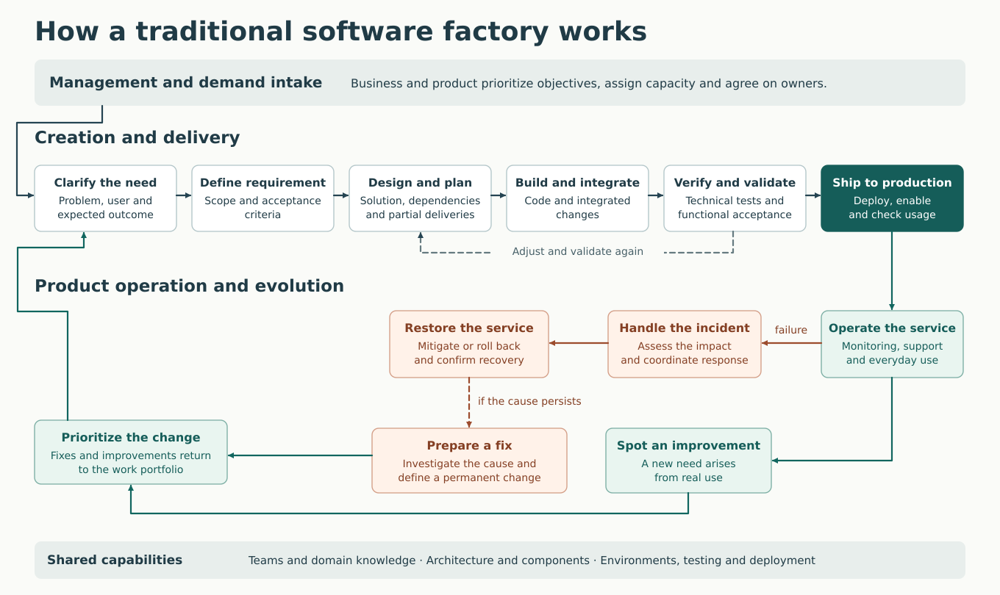
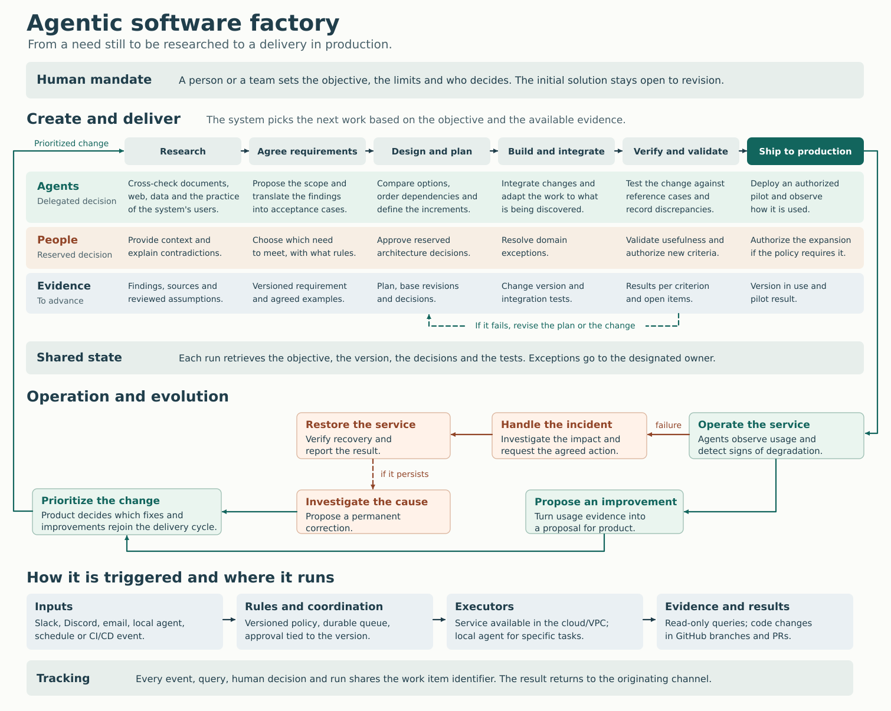

# From the traditional software factory to the agentic factory

> **Evidence.** Translated from Spanish on 2026-11-24. Original: "De la fábrica de software tradicional a la fábrica con agentes", working document, 2026-11-21, updated 2026-11-22, kept in the research workspace. Redactions are marked `[redacted: reason]`.

**Working document · Updated November 22, 2026**

An organization receives a need, decides to address it and delivers a software capability that someone can use in production. Once that capability is in use, the organization must sustain it and decide how it will evolve. This path is the common basis of both models. The distinction we propose to study is **who turns an agreed goal into the next work decision, with what authority and on the basis of what evidence**.

## 1. What a software factory does

We define a **software factory** as an organization with a repeatable capability to turn requirements into software in production and to operate, maintain and evolve the products it delivers. The repeatability lies in the organization keeping the knowledge, the responsibilities and the means of delivery from one change to the next. How those responsibilities are assigned may vary between teams or be agreed with the client. The idea of the factory as a way of organizing engineering work has antecedents in Cusumano's studies. [Cusumano, *The Software Factory Reconsidered*](https://hdl.handle.net/1721.1/11025)

| Factory level | Decision or capability it explains |
|---|---|
| Direction and demand management | Which problem to address, for whom, with what priority and who answers for the result. Includes deciding when an urgent matter displaces planned work. |
| Creation, delivery and service | How to take a requirement to production, operate the delivered capability, restore service after incidents and incorporate fixes and improvements. |
| Shared capabilities | What makes it possible to repeat the process across teams and deliveries. Includes domain knowledge, architecture, reusable components, environments, tests and deployment mechanisms. |

### From requirement to production

We follow a single work item throughout the document. A chain of stores wants its store managers to be able to download the day's sales and reconcile them with the daily cash closing.

| Stage | Decision to be made | Evidence in the store case |
|---|---|---|
| Understand the need | Who uses the result and what task do they want to complete? | The store manager shows how they prepare the closing and where manual copying comes in today. |
| Define and prioritize | What behavior is accepted and what is left for another delivery? | The business agrees which sales and returns belong to the business day and provides a known closing. |
| Design and plan | How to solve it in the existing product, and with what initial scope? | The source of the amounts is identified, along with who has access and in which store the feature will be tested. |
| Build and integrate | How is the change incorporated into the system? | An identified version integrates the export, the calculation and the permissions check. |
| Verify and validate | Does it meet the agreed rules, and does it serve the real work? | The tests cover returns and the date change. The store manager checks the file against their reference closing. |
| Release and check in production | Can the feature be used under the expected conditions? | The pilot store performs a real closing. Its result informs the decision to expand availability. |

The stages allow iteration. If validation reveals that the business day ends at two in the morning, the work goes back to the requirement. A test that fails during construction generates work within the creation process. An incident in a store that already depends on the feature triggers another process, with its own goal and closure criterion.



### What happens after delivery

| Process | What triggers it | Result that makes it possible to evaluate it |
|---|---|---|
| Day-to-day operation | There is a service in use. | During the observation window, the feature is available and the stores can complete their closings. Operation continues. |
| Incident response | A degradation prevents or hinders work. | The impact is contained and it is confirmed that the service has been restored. A rollback can achieve this. |
| Corrective maintenance | A defect is identified that requires a permanent change. | The fix goes back into the delivery cycle, is tested and is verified in production. |
| Evolution | Use reveals another need, such as splitting sales by payment method. | A new requirement is prioritized and, if accepted, the improvement is delivered and validated. |

For example, a rollback at 20:15 can let the stores do their cash closing again. At that point the service can be considered restored. A mishandled return may still be the outstanding cause. Its fix will have its own owner, version and delivery evidence. [Google SRE, *Managing Incidents*](https://sre.google/sre-book/managing-incidents/)

## 2. What changes when the process is delegated to agents

We propose calling a factory an **agentic software factory** when people delegate a result to it and grant the system bounded authority to organize the work across stages, act on the product, check progress and escalate the decisions that exceed its mandate. Coordination may be distributed among agents or rest with a coordinator that reuses an executor. To apply the definition, one has to state the segment in which that delegation actually operates.

A team may use one assistant to draft requirements, another to program and a continuous integration pipeline to deploy. If a person interprets each output and formulates each next work item, that person is still coordinating the path. In the agentic model, the system can choose the next action based on the goal, the state of the product and the available evidence. Human authorization of a deployment is compatible with both models. The difference shows in how the change reached that decision and who resumes the work afterwards. [Hua, *Beyond the Agent Harness*](https://www.alphaxiv.org/pdf/2611.06946?page=1) · [Hassan et al., *The Software Engineering Factory*](https://www.alphaxiv.org/pdf/2611.21623?page=1)

### Four observable conditions

1. **A verifiable work item.** The goal, the constraints, the acceptance examples and the questions that still require business knowledge are made explicit.
2. **Continuity between runs.** The requirement, the decisions, the code revision and the test results stay linked. Another session, agent or person can pick up the work.
3. **Bounded authority.** It is clear what the system can decide and execute, what requires authorization and in which situations it must stop. Permissions may vary between development, pilot and general production.
4. **Acceptance independent of the executor.** The agreed criteria change only through an authorized and traceable decision. The factory may propose correcting a wrong test and present its reasons. A modified test needs a justification that makes it possible to distinguish a rule change from a software repair.



### The same daily cash closing, under delegation

| Segment | What the factory can take on | What the person keeps in this example |
|---|---|---|
| Research | Compares the initial request with known closings and detects that a sale at 00:30 calls the calendar-day assumption into question. | The store manager provides examples and explains how the shift is organized. |
| Requirements agreement | Proposes a reconciliation rule and examples that cover the change of day. | Product decides the scope based on the evidence and approves a specific version. |
| Design and construction | Once the rule is recorded, the system resumes the work, draws up a plan, reuses the existing exporter and integrates the changes. | Engineering reserves decisions such as changing the official accounting source. |
| Validation and delivery | Checks totals against reference data, documents discrepancies and deploys to the pilot if the mandate allows it. | The store manager validates the usefulness of the file. The product owner may reserve the expansion to other stores. |
| Operation and evolution | Observes the results, requests or executes a mitigation with separate operational authorization, and records a fix or an improvement proposal separately. | Operations takes command in an incident outside the delegated scope. The business prioritizes the new demands. |

Here, human participation contributes domain knowledge and authority over relevant decisions. Autonomy can be described **by process and by decision**. A factory could coordinate design, construction and testing while the client keeps deployment and operation. In that case, the evidence of autonomy extends as far as the version delivered to the client. Attributing the production segment to it would require observing it.

## 3. How the agentic factory is activated and operates

### Research can change what gets built

The input may be a need, an observation or a solution that someone already has in mind. Before agreeing on requirements, the agent formulates the question it needs to resolve, consults documents provided by people, searches public information when it contributes evidence and checks what it finds against the code, the authorized data and the people who know the domain. It records the source and its version or date, the assumption it supports or contradicts and the doubts that require a decision. Research may be brief for a known change and may be reopened if contradictions appear during validation.

In the store example, "export sales by calendar day" might be the first request. A shift manual, real closings and an interview could show that sales at 00:30 belong to the previous shift and that hours vary between stores. The agent would explain what would be lost by grouping by date and would propose reconciling by shift and store. Product can accept that reframing, ask for more evidence or archive the work item. The result of research is a better-informed decision, which may even avoid building a feature. This example is hypothetical. As a precedent, iReDev studies requirements elicitation, analysis and validation with domain knowledge, human participation and shared artifacts that trigger actions. [Jin et al., *iReDev*](https://www.alphaxiv.org/pdf/2507.13081?page=1)

### The prompt, the event and the authorization

A coding agent can solve a multi-step task after a single prompt. The factory adds the ability to start or resume a work item when a condition that someone defined in advance is met. It helps to distinguish four elements:

| Element | Role in the factory | Example |
|---|---|---|
| Standing instruction | A versioned policy in YAML or in shared code defines when to act, on which project, with which tools and how far. A CI/CD engine or a service interprets the rule. | When new evidence arrives about an open work item, research it and propose changes to the requirement. |
| Event | A human request, a schedule, a change in GitHub or an operational signal identifies the work that could begin. | A store manager attaches two closings in the project's Slack thread. |
| Work item for the executor | The coordinator combines the current rule, the event, the previous state and the authorized references to compose the prompt for that run. | Compare those closings with the current requirement and present the discrepancy. |
| Human decision | An identified person accepts, rejects, requests changes to or pauses a specific action. The decision stays linked to the version presented. | Product confirms the shift rule. An approval of requirements enables planning; deployment follows its own policy. |

Conceptual example of a rule that the team could maintain. It is an illustrative outline of the factory; the executable syntax will depend on the engine chosen.

```yaml
event: document_added_to_work_item
condition: requirement_under_discussion
task: research_and_propose_revision
sources: [work_item_documents, project_vault, public_web]
output: [findings_with_sources, difference_from_current_requirement]
reply_in: originating_thread
to_agree_on_requirement:
  approver: product_owner
  link_to: proposal_version
```
*(Identifiers translated from Spanish.)*

Slack, Discord, email and the local coding agent can be used to open a work item, provide evidence or reply. The factory keeps an identifier shared across channels. A notification presents the pending decision, the evidence and the affected version. An authorized reply resumes the corresponding step; duplicate delivery of an event retrieves the same work item. In a one-person project, the same person can request and approve at two different moments. In a team, the policy can assign decisions by product, repository or environment and reserve certain changes for a second person. The absence of a reply leaves that decision pending.

### Cloud execution and local participation

We propose a service that is continuously available in a virtual private cloud (VPC). It receives events, keeps the work item queue, stores decisions and dispatches work to executors with Claude Code, Codex or OpenCode. Availability is measured by the capacity to receive and resume work items; each inference process can start when there is work. The dossier identifies the executor, the model, the policy version and the revisions of the repositories used.

The agent on the person's machine has two roles. As a **channel**, it makes it possible to ask about a work item, open one or approve a proposal from the terminal. As an **executor**, it can receive a bounded task that needs a local file, tool or environment and return only the agreed result. If the computer is offline, the work item keeps its state. Reassignment to the cloud only proceeds if the necessary inputs and permissions are available there.

| Resource | Access in the proposed model | Evidence it keeps |
|---|---|---|
| Operational sources | Read-only queries to logs, Sentry, PostHog and databases through MCP, CLI or scripts created by the agent. The permissions of the query identity also limit the scripts. | Source, queried interval, query version and relevant result. |
| Code repositories | GitHub hosts the shared revisions. The factory syncs when it receives changes, checks the revision when it starts work and prepares changes in branches and pull requests. | Base revision, proposed change, tested revision and integration decision. |
| Knowledge vaults | They are Git repositories of documentation. The factory keeps up-to-date local copies so it can search by content with grep or ripgrep; each run works with identified revisions. | Sources are cited by file and commit. Agents write plans, decisions, logs and verifications in the authorized vaults. |

A Sentry signal can justify starting research. Permissions on production remain read-only during diagnosis. A fix is proposed in GitHub, and any operational action uses the authorization defined for that environment. Nor does a VPC replace the identity and scope of each connection.

### The VPC multi-repository workspace

The unit of work is the **work item**. A single agent may need several code repositories and several vaults to resolve it. Conversely, a QA vault may document a problem that spans two products, and a domain decision may affect the API, the interface and an SDK. We propose a per-project catalog that identifies each repository, its purpose, the domain it covers, its owners and the permissions of each role. When it takes a work item, the agent obtains the authorized copies, updates the references and records the branch and commit it actually inspected in each one. That way it can search for an identifier, a rule or a business term with `rg` across the relevant set.

| If the work item affects the service, the interface and QA… | What the agent reads | What it can write according to its mandate |
|---|---|---|
| Code repositories for the service and the interface | Contracts, implementation, tests and base revisions of both repositories. | Branches and change proposals per repository, linked to the same work item. |
| Engineering or domain vault | Current diagnosis, previous decisions and the iteration plan. | Research findings, plan updates and a log of what it did. |
| QA vault | Bug record, expected behavior, regression case and previous verifications. | Evidence of reproduction or of a new test, with version, environment, result and author. |
| Other relevant vaults, for example design | Interaction contract, background and acceptance criteria. | Proposals or annotations within the granted scope. Changes to criteria are attributed to whoever approves them. |

Each repository keeps its own history and permissions. If the fix requires two PRs, the dossier keeps the state of both. If another agent updates a note while the first one is working, the first one rereads the current version and integrates its contribution. A disagreement about scope is kept as an open question until it is resolved. The local agent can leave an annotation in the same dossier so that the VPC agent continues from it.

### The vault as memory that agents also write

**Practice observed at Woku.** The engineering vault organizes initiatives by iteration, with a diagnosis against an identified revision and a phased plan that is updated during implementation. In the second iteration of [an internal woku project] there is a log indexed by step and a review record that collects fixes, reproducible evidence and a pending limitation. In QA, the bug template captures expected and actual behavior, reproduction steps, environment, evidence and developer notes. A dated lesson learned documents why two fixes found in a remote branch were left pending functional verification. It is a precedent of work with coding agents that we can carry over to the factory model.

Local sources consulted on November 22, 2026 in Woku's development workspace:

- Engineering vault, local HEAD [redacted: internal woku reference]: [redacted: internal woku reference], [redacted: internal woku reference] and [redacted: internal woku reference].
- QA vault, local HEAD [redacted: internal woku reference]: [redacted: internal woku reference] and [redacted: internal woku reference].

**Proposed extension for the factory.** Writing to the vault is part of the delegated work. The agent consults the background when it starts and writes when something changes that whoever takes the next turn must know. The following table describes the records by their function. A small team can keep the plan and the log in the same note.

| Record | When the agent itself writes | What it leaves for whoever continues |
|---|---|---|
| Research and diagnosis | A source changes the interpretation of a requirement, or evidence appears that contradicts an assumption. | Question, source and revision, observation, hypothesis and open doubt. |
| Plan and log | It agrees on a phase, completes a step, discards an attempt for a specific reason, or a blocker appears. | Current scope, what it tried, result, links to changes and next step. It notes the failed attempt when repeating it would waste work. |
| Decision | It proposes an alternative or receives an authorized resolution, including from Slack or the local agent. | Alternatives, reason, scope, who decided, date and reference to the approval. A later decision links to the one it replaces. |
| Bug and fix | It reproduces the behavior or changes the code to resolve it. | Stable ID, expected and observed behavior, reproduction procedure, confirmed cause or hypothesis, affected repositories and the PR/commit of the fix. |
| Verification | It runs the test on an identified version or detects a regression. | Case, environment, revision or combination of revisions, result, evidence and pending items. If it fails, it updates the same record and reopens the work. |

**Hypothetical handoff example.** The implementation agent writes: "The service now groups sales by shift. The interface still sends the calendar date. The two PRs and the 00:30 reference closing are linked. Still pending: testing both changes together in the pilot." The QA agent searches for the ID, retrieves the two revisions, runs the case and adds the result to the same record. Whoever picks it up tomorrow can tell what was decided, what code was changed and where it was verified.

Annotations carry a human or agent author, a date and the identifier of the work item or run. Bulky or sensitive evidence is referenced with appropriate access. Retries update the entry for the same event to avoid duplicates. An observation or hypothesis can be recorded immediately; marking a decision as approved or a delivery as verified requires linking the corresponding authority or evidence. The rules that trigger work follow their own change process: writing a log does not by itself authorize a deployment. The practical test of the vault is whether a second agent can continue from the records, with the assigned permissions, without asking the person to reconstruct the chat.

### What to observe and how to fund the executors

Besides observing the product in production, the factory must be able to observe its own work. For each work item, the aim is to reconstruct which event started it, which policy authorized it, which executor took part, which sources it consulted, which decision was requested from whom and how it ended. To evaluate performance, it helps to distinguish queue time, execution time and human waiting time. To evaluate collaboration, it helps to count clarifications, approvals, rejections and rework, and to check whether the delivery was accepted. If a work item takes two days and spent almost all of that time waiting for a decision, increasing the number of executors is unlikely to fix the delay.

The economic preference is to make use of the available subscriptions when the provider and the plan allow the type of execution. To choose, compare the attributed share of the fee, usage limits, waiting time once the allowance runs out and cost per accepted change. A person's interactive mode and an unattended executor in the VPC must be checked separately. OpenAI documents subscription access and recommends API keys for general programmatic workflows; it also describes Enterprise access tokens for authorized automations. Anthropic documents specific conditions for running Claude Code on hosted infrastructure offered to users, including each user's own authentication. OpenCode offers several connections, including subscription-based modes. The choice of provider and plan remains open. Moving to usage-based billing requires an explicit budget decision. [Codex authentication](https://developers.openai.com/codex/auth/) · [Claude Code conditions](https://code.claude.com/docs/en/legal-and-compliance) · [OpenCode providers](https://opencode.ai/docs/providers/)

## 4. What the literature supports and what remains to be checked

The diagrams and conditions above are our **working synthesis**. The studies reviewed document different segments. ChatDev makes it possible to observe how a requirement passes through design, programming and testing. Jiang and Lysenko study agent-coordinated maintenance on existing repositories. In one of their cases, they detected incorrect repairs in at least 25 of 450 issues marked as fixed. Pavlenko and colleagues describe using operational signals to select optimizations and send proposals to engineering review. Each case provides evidence about its own path. [ChatDev](https://aclanthology.org/2024.acl-long.810/) · [*Instant Software Factories*](https://www.alphaxiv.org/pdf/2610.36254) · [*Towards an AI Software Factory for Data Systems*](https://www.alphaxiv.org/pdf/2609.36323)

To evaluate research, we propose starting from the same initial need and checking which assumptions each process confirms, modifies or discards. To compare the subsequent execution, it is advisable to fix the same agreed requirement, the same meaning of delivery and the same acceptance criteria. The store case makes it possible to formulate three questions that remain open:

- **Scope of delegation.** Up to which decision could the factory get without a person having to reconstruct the context and formulate the next work item?
- **Effort and quality.** For each accepted change, how much human time was spent clarifying, reviewing, intervening and repairing afterwards? What did the failed attempts cost, and what defects appeared in a common follow-up window?
- **Operational result.** Did the store manage to reconcile the closing in production? If there was an incident, how long did it take to restore service, and when was the permanent fix verified?

The unit of creation is the **requirement put into production**. The unit of incident response is the **restored service**. The unit of maintenance or evolution is the **change verified in production**. Keeping those three units explicit makes it possible to compare factories without confusing internal activity with results for the people who use the software.
