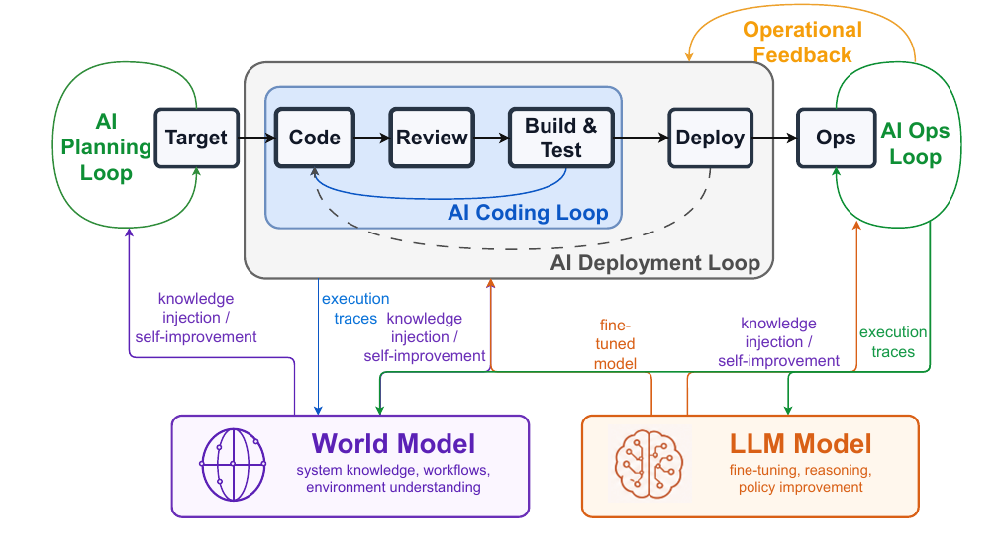

# Agentic software factories

> **Evidence.** Translated from Spanish on 2026-11-24. Original: "Fábricas de software con agentes", exploratory literature review, 2026-11-21, kept in the research workspace. Redactions are marked `[redacted: reason]`.

Initial exploratory review · November 21, 2026

**Research question.** Which decisions in the delivery cycle can an agent system take on, from the moment it receives a goal until someone accepts the change, and what evidence makes it possible to know whether that delegation improves the result?

**Working definition.** We will call an *agentic software factory* a system that receives a product or maintenance goal, coordinates several stages of the work in a repeatable way, and keeps evidence that makes it possible to accept, correct or escalate the result. A person may set priorities, clarify requirements and authorize a release. What matters is recording who decides the next step, what information they receive and what happens when something fails. This definition is a proposal for selecting studies. The number of agents, the titles of their roles and the presence of a person in the final approval are independent dimensions.

## From work item to operation

Figure 1 from Pavlenko and colleagues. The top arrow feeds operational information back into planning. To study an implementation of this architecture, it helps to find a concrete change whose need was detected in operation and follow it until it is accepted. The figure describes the authors' vision. [Towards an AI Software Factory for Data Systems, p. 1](https://www.alphaxiv.org/pdf/2609.36323?page=1)

## Six annotated readings

1. **Qian et al., ChatDev (ACL 2024).** A requirement expressed by the user sets off conversations among agents specialized in design, programming and testing. The sequence of dialogues makes it possible to observe what one role hands to the next. It is a precedent for studying the initial creation of a product. Its evaluation leaves open the question of who maintains that product after delivery. [Paper at ACL](https://aclanthology.org/2024.acl-long.810/)
2. **Jiang and Lysenko, Instant Software Factories (2026).** The starting point is a repository with tests. Periodically scheduled agents receive standing goals and coordinate work through shared records. The authors observed two industrial installations configured manually over 15 and 17 days. In one, the agents went so far as to modify the continuous integration checks themselves. At least 5.6% of the issues marked as fixed had an incorrect fix that was identified later. The method proposed for installing a new factory through a single round of instructions has yet to be evaluated in the paper. [Text, p. 1](https://www.alphaxiv.org/pdf/2610.36254?page=1)
3. **Pavlenko et al., Towards an AI Software Factory for Data Systems (2026).** The authors describe applications in Microsoft repositories, focused on changes with a measurable goal, such as optimizing the performance of a component. It is a favorable case for delegation because there is a signal against which each attempt can be evaluated. When describing change review, they distinguish the prior automated work from human review and describe as anecdotal the evidence that this stage has become shorter. It is worth extracting the results by stage. [Scope, p. 1](https://www.alphaxiv.org/pdf/2609.36323?page=1) · [Review, §2.4](https://www.alphaxiv.org/pdf/2609.36323)
4. **Hua, Beyond the Agent Harness (2026).** Proposes placing the boundary of the factory where the system coordinates different runs, transfers state to them or modifies how they work based on their results. This criterion helps classify a system that uses the same agent across several sessions. It arises from the case of a single operator with six projects. The check with two models from the same family measures classification agreement and leaves validation with human raters pending. [Text, p. 1](https://www.alphaxiv.org/pdf/2611.06946?page=1)
5. **Yang et al., (When) Should a Software Factory be Lights-off? (2026).** CRBugBench pairs human-verified bugs with the change proposals that introduced them. It evaluates whether a reviewer agent finds those bugs. Performance drops on changes that require reasoning beyond the local code and in the industrial repositories studied. It is evidence about one specific checkpoint. Evaluating a factory also requires following what happens to the defect through to deployment or correction. [Text, p. 1](https://www.alphaxiv.org/pdf/2610.13668?page=1)
6. **Peng et al., The Impact of AI on Developer Productivity (2023).** In a controlled experiment, developers implemented an HTTP server in JavaScript, with or without access to GitHub Copilot. The study makes it possible to attribute a difference in task time to access to the assistant under those conditions. It serves as a comparator because the work item is defined and the person keeps the coordination. To compare a factory with this way of working, both would need to be given the same goal and held to the same acceptance criteria. [Text, pp. 1 and 2](https://www.alphaxiv.org/pdf/2302.06590?page=1)

## How to expand the review

The initial search in alphaXiv and OpenAlex combined "agentic software factory", "software factory" and "multi-agent software development" with questions about the path from requirement to delivery. An additional search in OpenAlex retrieved the individual productivity comparator. Original works were prioritized according to their ability to document decisions, handoffs, verification and human participation. The selection is deliberate, exploratory and not filtered by year. The presence of a preprint in the corpus indicates topical relevance. The maturity of its evidence is described in each entry.

For the main corpus, include studies with an explicit software goal, at least two stages coordinated by the system and an inspectable output. Keep individual assistants and works that evaluate a single stage as comparators. Record architectural proposals, laboratory demonstrations, field studies and experiments with a comparator separately. Two candidates for the next screening are *MetaGPT*, for the procedures between roles, and *Human-In-The-Loop Software Development Agents*, for human intervention. [MetaGPT](https://www.alphaxiv.org/pdf/2308.00352) · [Human-In-The-Loop Software Development Agents](https://doi.org/10.1109/ICSE-SEIP66354.2025.00036)

For each paper, follow one unit of work from start to finish and fill in five fields.

| Field | Extraction question |
|---|---|
| Input and scope | Does the system receive an idea, a specification, an issue or an operational signal? Does it start from scratch or modify existing software? |
| Coordination | Who decomposes the goal, assigns the next task, keeps the state and decides whether to retry or escalate? |
| Human authority | What must a person initiate, clarify, review and authorize? Is the time they spend measured? |
| Acceptance | Is the deliverable generated code, executable software, an integrated change or a version in use? Who defines and checks the criterion? |
| Results and evidence | What comparator is used? Are total time, human effort, cost per accepted change and later defects recorded? How long does the follow-up last? |

**Open question that deserves to guide the project.** With the same goal and the same acceptance tests, when does the factory reduce total human time per accepted change, and how much work reappears later as review, rework or incidents? The maintenance study offers a concrete reason to measure both sides. If agents can open issues, close them and edit the checks that validate them, activity volume and delivered quality need independent measurements. [Instant Software Factories, p. 1](https://www.alphaxiv.org/pdf/2610.36254?page=1)
