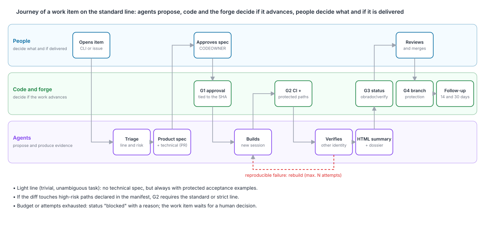
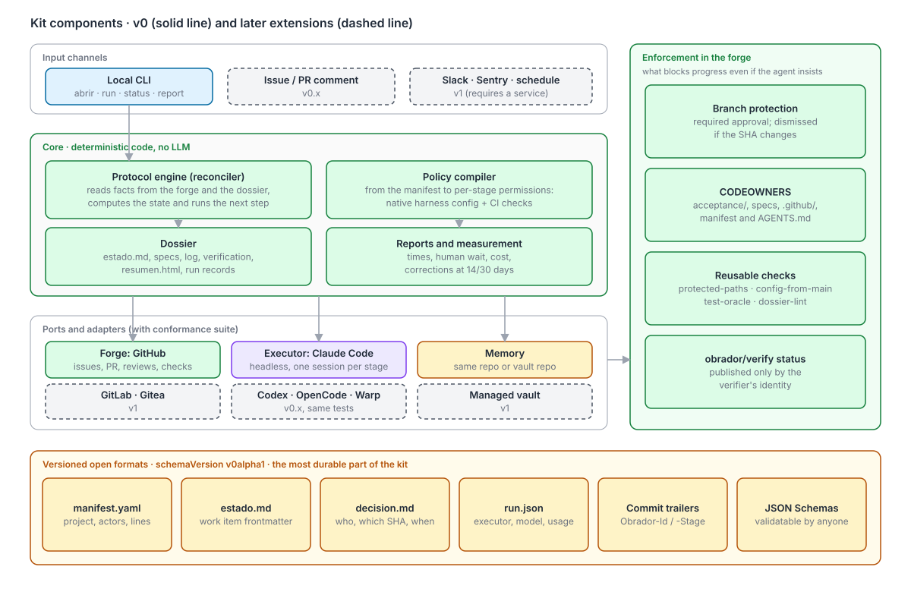

# Model and architecture of the public agentic software factory kit

> **Evidence.** Translated from Spanish on 2026-11-24. Original: "Modelo y arquitectura del kit público de fábrica de software con agentes", design proposal v0, 2026-11-22, kept in the research workspace. Redactions are marked `[redacted: reason]`. The kit's provisional name at the time was "obrador"; the project was later named Telar. Names are kept as written.

**Design proposal · v0 · November 22, 2026.** Maintainer: Diego Orrego ([@diorrego](https://github.com/diorrego)). Provisional name: **obrador** (see §11). Woku is the first installation and the reference case; the kit is published so that other people and companies can set up their own factory.

For the v0, this document replaces the [single-project pilot](2026-11-22-pilot-architecture.md) and the [multi-project design](2026-11-22-multi-project-architecture.md). Both remain as reference for v1. The reasons for each decision are in the [critical review](2026-11-22-critical-review-and-version-zero.md). They are cited here by section, for example "(review §2.3)".

---

## 1. What it is and what it is not

**It is** a protocol with open formats, plus a CLI, adapters and CI checks that enforce it. With them, a team turns its GitHub repository into a line where agents research, specify, build and verify, and where progress is decided by executable rules and identified people.

**It is not** a hosted platform, nor a new coding agent, nor a swarm orchestrator. The kit uses the agent the team already has (Claude Code in the v0) and the forge it already uses (GitHub). The v0 needs no server, database or cloud.

**Verifiable promise of the v0.** A team with a GitHub repository and an agent CLI installs the kit in an afternoon. Then it takes a work item from end to end, from the issue to the merged PR, with a dossier, gates and metrics. It can check this first with the included example project, without access to anything private.

## 2. Design principles

| # | Principle | Consequence in the design | Support |
|---|---|---|---|
| P1 | **Agents propose; code and people decide.** | No transition that produces effects depends on generated text. Gates are predicates over facts in the forge. | review §2.2; Hassan et al. |
| P2 | **First the workshop, then the line.** | `obrador init` first installs the deterministic controls (protected paths, checks, CODEOWNERS) and then the automation. | review §2.1; Tan, Ronacher |
| P3 | **Acceptance is not touched by whoever builds.** | `acceptance/` is owned by product or QA, the builder is denied write access to it, and the verifier uses a different identity. | review §2.3 |
| P4 | **State lives in Git and in the forge.** | No database in the v0. The engine reconciles state from issues, PRs, reviews, checks and the dossier. | adoption; auditing |
| P5 | **A new session per stage, with context from the dossier.** | No compaction threshold policy. What cannot be recovered from the repository (decisions, alternatives, next steps) goes into the dossier. | review §2.5; CompAct-Bench |
| P6 | **Rigor proportional to risk.** | Light, standard and strict lines. High-risk paths declared in the manifest escalate the line automatically. | review §2.9; Hassan, P7 |
| P7 | **Formats before tools.** | Versioned JSON schemas. Any harness or forge can implement them. | review §5; Ronacher |
| P8 | **Secure by default.** | Configuration read only from `main`, no permission rules created by agents, only registered actors, and minimal outbound network. | review §2.7 |
| P9 | **Measure against the current mode.** | `obrador report` produces the same metrics for work items done with the factory and without it. | review §2.4, §4 |

## 3. Conceptual model

| Entity | Definition | Where it lives |
|---|---|---|
| **Installation** | Where the kit runs: the machine of whoever triggers it (v0), a CI runner (v0.x) or a service (v1). | Local configuration |
| **Project** | A software product with its repositories, memory, actors, lines and risk paths. | `.obrador/manifest.yaml` in the main repository |
| **Actor and role** | A person or service identity (builder, verifier) with roles: `product`, `qa`, `maintainer`, `builder`, `verifier`. | Manifest + CODEOWNERS |
| **Work item** | A unit of work with a stable ID (`OB-<n>`), linked to an issue. | Dossier `dossiers/OB-<n>/` in the memory |
| **Line** | A sequence of stages according to risk: `light`, `standard`, `strict`. | Manifest |
| **Stage** | A bounded step with inputs, permissions, outputs and an exit gate: `triage`, `spec`, `build`, `verify`, `handoff`. | Manifest |
| **Gate** | A deterministic predicate that allows advancing: a role's approval on a SHA, green checks, an artifact present, a status published by an identity. | Manifest + branch protection |
| **Call-out** | Text injected into a stage's instruction when a condition is met. It guides and does not block. | Manifest |
| **Run** | One invocation of an executor for a stage. | `runs/<stage>-<n>.json` in the dossier |
| **Evidence** | Spec, log, verification, screenshots, traces and summary. | Dossier (large attachments by reference) |
| **Decision** | An authenticated human act on a specific version: approve, request changes, discard, merge. | Forge (review or merge) + `decisions.md` |

**Key relationships.** A project has many work items. A work item follows a line, which has stages, and each stage has a gate. Each stage produces runs and evidence. A gate is satisfied by facts (checks, statuses) or by decisions, always referring to a SHA. A decision is never inferred from the agent's text.

### Work item states

```text
open → triaged → spec_proposed → spec_approved → building → candidate
     → verified → delivered → (followed_up)
from any state: blocked(reason) · discarded
verify with a reproducible failure → building (attempt n+1, up to budget.attempts)
```

State is not stored as an independent truth. `state.md` is a **readable cache** that the engine recomputes from the facts. If the cache and the forge disagree, the forge wins.

## 4. Journey of a work item



| Stage | Who | Inputs | Can write | Exits when (gate) |
|---|---|---|---|---|
| `triage` | agent | issue, manifest, `AGENTS.md` | `state.md` (line proposal) | The effective line is the maximum of the agent's proposal and the line required by the risk paths. Deterministic. |
| `spec` | agent | issue, current product specs, code | PR to the memory with `product-spec.md` (invariants and examples), `technical-spec.md` and the proposed `acceptance/` tests | **G1.** An *approved* review from an actor with the `product` role on the **head SHA**, and the PR merged. With "dismiss stale approvals" enabled, a new commit voids the approval. |
| `build` | agent (new session) | approved spec (SHA), dossier | Branch `obrador/OB-<n>/build`, only in the allowed paths | **G2.** Required checks green, plus `obrador/protected-paths` (the diff does not touch `acceptance/`, `.github/`, `.obrador/manifest.yaml`, `AGENTS.md` or the lint configuration) and `obrador/test-oracle`. If the diff touches risk paths, the corresponding line is required. |
| `verify` | agent with the `verifier` identity | candidate SHA, `acceptance/`, *feature map*, environment | `verification.md` and `evidence/` in the dossier. It cannot write code. | **G3.** Status `obrador/verify = success` on the candidate SHA, **published by the verifier's identity**. If it is `failure`, it goes back to `build`. |
| `handoff` | agent | complete dossier | `summary.html` (what, why, evidence, pending items) and a comment on the PR | **G4.** Human merge under branch protection: CODEOWNERS plus all statuses on the head SHA. |
| follow-up | code | `git log`, linked PRs | report | Not a gate. Measures fixes and reverts at 14 and 30 days. |

**Light line.** No `technical-spec.md`, and spec approval reduced to the acceptance examples. G2, G3 and G4 remain. **Strict line.** Adds a second human approval at G1 and G4 and a mandatory security or data call-out in `build`.

## 5. Architecture



### 5.1 Protocol engine: a reconciler with no state of its own

`obrador run OB-<n>` executes **one reconciliation step**, like a Kubernetes controller:

1. **Observe.** Reads the issue, the PRs marked with `<!-- obrador:id=OB-12 stage=build -->`, the reviews, the checks, the statuses and the dossier on `main`.
2. **Compute.** Determines the effective state and which gate is pending.
3. **Act.** If the current stage's gate is met, launches the next stage. If not, reports what is missing and to whom.
4. **Record.** Writes `runs/*.json` and updates `state.md` on the stage's branch.

**Idempotency without a database.** Branch names are deterministic (`obrador/OB-<n>/<stage>`). The PR marker makes it possible to find the existing PR before creating another one. Commits carry *trailers* (`Obrador-Id`, `Obrador-Stage`, `Obrador-Run`). Repeating `run` does not duplicate effects. A lock with `git` (branch `obrador/OB-<n>/lock` or a *lease* in a comment) prevents two simultaneous runs of the same work item. `obrador watch` repeats `run` over the open work items every N minutes. It is the simplest form of a "permanent factory" without a server.

### 5.2 Policy compiler

The compiler translates the manifest into two independent layers of control:

1. **Native harness configuration** for the stage's session: allowed and denied write paths, allowed commands, and network. In Claude Code these are `permissions.deny` and `allow` rules in an ephemeral `settings`. In Codex it will be the sandbox mode. It is a preventive defense and can fail.
2. **CI checks** that check the result: `protected-paths` compares the diff with the stage's policy. This defense does not depend on the agent.

Agents **cannot** add permission rules. The allowlist only changes through a PR to the manifest, which is owned by the maintainer according to CODEOWNERS.

### 5.3 Ports and adapters

| Port | Contract | v0 | Later |
|---|---|---|---|
| **Forge** | read issues, PRs, reviews, checks and statuses; create a branch, PR, comment and status | GitHub, with `gh` or a GitHub App | GitLab, Gitea |
| **Executor** | `start(task) → stream<event>`, `cancel(run)`, `capabilities()` | Claude Code headless | Codex, OpenCode, Warp worker |
| **Memory** | read and write the dossier in a Git repository | the same repository (`.obrador/dossiers/`) or a vault repository | managed vault |
| **Channel** | open, query and notify | CLI | `/obrador` comments on issues (v0.x), Slack (v1) |

```ts
// Minimal executor contract (package @obrador/core)
interface StageTask {
  dossierId: string; stage: "triage" | "spec" | "build" | "verify" | "handoff";
  workdirs: { repo: string; path: string; baseSha: string }[];
  instructions: string;            // stage template + call-outs; never issue text interpolated into a shell
  policy: { allowWrite: string[]; denyWrite: string[]; allowCommands: string[]; network: string[] };
  budget: { attempts: number; maxMinutes: number; maxTokens?: number };
}
type ExecEvent =
  | { type: "message" | "tool"; data: unknown }
  | { type: "usage"; inputTokens?: number; outputTokens?: number; unknown?: true }
  | { type: "done"; status: "done" | "blocked" | "budget_exhausted" | "error"; summary: string };
interface ExecutorAdapter {
  capabilities(): { nativePolicy: boolean; reportsUsage: boolean; resume: boolean };
  start(task: StageTask): AsyncIterable<ExecEvent>;
  cancel(runId: string): Promise<void>;
}
```

**Conformance suite.** An adapter is only published if it passes these tests, with the example repository:
- it respects `denyWrite`, and if it cannot, it declares so with `nativePolicy: false`;
- it reports usage or returns `unknown`;
- it stops when the budget is exhausted;
- it returns a structured `done`;
- it receives no write secrets in its environment.

This is how Claude Code is compared with Codex in v0.x, with the same tests (review §2.10).

### 5.4 Identities

| Identity | Permissions | v0 |
|---|---|---|
| Person who triggers | their own; approves according to role | GitHub account |
| `builder` | write `obrador/*/build` branches and open PRs | the person's token or the GitHub App's, limited to the repository |
| `verifier` | read code, write only to the dossier, publish the `obrador/verify` status | **separate identity** (GitHub App or bot account). Without it, the installation is marked as "non-independent verification" in every report. |

## 6. Open formats (v0alpha1)

Field names are in English to ease international adoption. The documentation is bilingual.

### 6.1 Manifest of the example project

```yaml
# .obrador/manifest.yaml
schemaVersion: obrador/v0alpha1
project:
  id: support-agent-example
  maintainers: ["@diorrego"]
repos:
  - { id: app, url: github.com/diorrego/obrador-example-support, primary: true }
memory: { repo: app, path: .obrador/dossiers }          # or a separate vault repo
actors:
  - { github: "@diorrego", roles: [product, maintainer] }
  - { github: "obrador-verifier[bot]", roles: [verifier] }
executor: { adapter: claude-code, version: "pinned", mode: local }
acceptance: { paths: ["acceptance/**"], owners: [product] }
risk:
  strict: ["src/billing/**", "src/auth/**"]
  standard: ["src/**"]
  light: ["docs/**", "*.md"]
lines:
  light:    [triage, build, verify, handoff]
  standard: [triage, spec, build, verify, handoff]
  strict:   [triage, spec, build, verify, handoff]   # + double approvals
stages:
  spec:
    gate: { approval: { role: product, bindTo: headSha, count: { standard: 1, strict: 2 } } }
  build:
    policy: { denyWrite: ["acceptance/**", ".github/**", ".obrador/manifest.yaml", "AGENTS.md"] }
    budget: { attempts: 3, maxMinutes: 45 }
    gate: { checks: [required, obrador/protected-paths, obrador/test-oracle] }
  verify:
    identity: verifier
    policy: { allowWrite: [".obrador/dossiers/{id}/**"] }
    gate: { status: { context: obrador/verify, state: success, setBy: verifier } }
  handoff:
    gate: { merge: { by: human, branchProtection: true } }
callouts:
  - { stage: build, whenPaths: ["src/billing/**"], say: "Billing change: check idempotency, currency and rounding." }
```

### 6.2 Dossier

```text
.obrador/dossiers/OB-12/
  state.md             # frontmatter: id, issue, line, state, stage, shas, blockedReason
  product-spec.md      # invariants and acceptance examples (long-lived)
  technical-spec.md    # the work item's plan (disposable)
  log.md               # attempts, discarded options and why, next step
  decisions.md         # reference to the review/merge: actor, SHA, date
  verification.md      # per criterion: expected, observed, evidence, SHA, environment
  summary.html         # for the human decision
  runs/build-1.json    # executor, version, model, start/end, usage, SHAs, result
  evidence/            # screenshots and small traces; large ones by reference
```

*(File names translated from Spanish.)*

The **handoff test** is a test in the suite: a new session, reading only the dossier and the repository, must be able to say what state the work item is in and what the next step is.

### 6.3 Run record

```json
{ "schemaVersion": "obrador/v0alpha1", "dossier": "OB-12", "stage": "build", "attempt": 1,
  "executor": { "adapter": "claude-code", "version": "x.y.z", "model": "…" },
  "startedAt": "…", "endedAt": "…", "baseShas": { "app": "…" }, "resultSha": "…",
  "usage": { "inputTokens": 0, "outputTokens": 0, "unknown": false },
  "status": "done", "transcript": { "stored": "local", "ref": null } }
```

Full transcripts **are not published by default**: they may contain private code or secrets. They are stored locally and publishing them is optional.

## 7. Secure by default

1. **Configuration only from `main`.** `AGENTS.md`, skills, the manifest and templates are read from the default branch, never from the PR's branch (GitInject).
2. **Triggers only from registered actors.** An issue or PR from an outside person does not trigger agents until someone with the `maintainer` role applies the `obrador:accept` label.
3. **No persistent permission rules created by agents** (*From Approval to Abuse*).
4. **Minimal outbound network** in the executor: the forge and the model provider. The v0 documents it; v1 enforces it in the container.
5. **Write secrets kept out of the executor** that reads external content. The verifier has no write token on the code.
6. **`SECURITY.md`** with a threat model, private reporting through GitHub Security Advisories, and a list of what the kit does *not* protect.

## 8. Installations

| | Example project (public) | Woku (private) |
|---|---|---|
| Purpose | Demonstrate and test the kit; basis of the conformance suite | First real installation and source of the measurement |
| Repositories | `obrador-example-support`: a support agent with contradictory guidelines and a billing query | Service and interface |
| Memory | `.obrador/dossiers` in the same repository | The existing engineering and QA vaults, as memory repositories |
| Verification | `acceptance/` tests + Playwright against a local app | The existing QA Playwright journeys + *feature map* |
| What is published | Everything | Only what Woku authorizes (review §5): aggregate metrics or anonymized dossiers |

Woku's manifest lives in Woku's private repository. The kit contains no reference to Woku except, if authorized, a mention as the first installation.

## 9. Structure of the public repository

```text
obrador/
  spec/                      # protocol and JSON Schemas (manifest, state, decision, run)
    protocol.md
  packages/
    core/                    # reconciliation engine, gates, policy compiler
    cli/                     # obrador init | open | run | watch | status | report
    forge-github/
    executor-claude-code/
  actions/                   # reusable GitHub Actions
    protected-paths/  config-from-main/  test-oracle/  dossier-lint/
  templates/                 # minimal AGENTS.md, specs, log, verification, summary.html
  conformance/               # suite for adapters and the handoff test
  examples/support-agent/    # reproducible reference project
  measurement/               # comparison protocol and metrics script
  docs/  es/  en/
  LICENSE  NOTICE  SECURITY.md  CONTRIBUTING.md  GOVERNANCE.md  CODE_OF_CONDUCT.md
```

TypeScript on Node, as already planned in the pilot, because the SDKs of the main harnesses have a TypeScript version and it makes distribution with `npx` easy. The package is published under a scope (`@diorrego/obrador` or a scope of its own) until the name is chosen.

## 10. Measurement

`obrador report --since 2026-12-01 --format csv` produces one row per work item, both for the factory's work items and for the "manual" work items labeled `obrador:baseline`:

| Field | Source |
|---|---|
| line, final state, attempts | dossier |
| cycle time; time waiting on humans (from the review request to the decision) | forge events |
| active human minutes | optional `obrador log <id> <min>`. Not inferred: the forge does not record it. |
| tokens or quota and estimated cost, including failed attempts | `runs/*.json` |
| human commits inside the agent's PR | authorship and trailers |
| fixes and reverts at 14 and 30 days | commits with `Obrador-Fixes: OB-<n>` or reverts of the merge |
| strength of the added tests | `obrador/test-oracle` |

The comparison protocol, with 10 to 15 alternated work items, equal criteria and objective recording, is in `measurement/README.md` and is followed at Woku (review §4).

## 11. License, governance and name

**Recommended license: Apache-2.0** for the whole repository: code, schemas and documentation.
- **Explicit patent grant, with a termination clause.** It matters to a company evaluating adoption, and MIT does not include it.
- **Permissive.** Any company can use it, modify it and integrate it into its own products. The goal is adoption, so network *copyleft* licenses (AGPL) and "source-available" licenses (BSL) are ruled out, since they hold back precisely companies.
- **Compatible** with the Node ecosystem and with including the kit in MIT or Apache projects.
- **Does not give away the trademark.** The name remains yours even though the code is free.

This is not legal advice. If Woku contributes its own code, it is advisable to confirm internally who holds the copyright before publishing it.

**Contributions: DCO, not CLA.** Every commit carries `Signed-off-by`, which is validated by a check. It is lighter than a CLA and consistent with the kit's traceability. **Governance** in `GOVERNANCE.md`: a single maintainer (@diorrego) who decides, with written acceptance criteria. It is reviewed on reaching three or more recurring contributors.

**Name.** Availability checked on November 22, 2026:

| Candidate | Idea | npm | Note |
|---|---|---|---|
| **obrador** | A workshop where things are made by hand. It captures Ronacher's idea of building the workshop before the factory. | free | A GitHub user `obrador` already exists; the repository would be `diorrego/obrador`. |
| **telar** | The Jacquard loom, the first programmed machine: "factory as code". | taken | A scope would be needed (`@diorrego/telar`). GitHub user `telar` taken. |
| relevo | The handoff between agents and people | taken | **Discard:** there is an active npm package with an almost identical purpose. |

I recommend **obrador**. The Spanish name sets the project apart, is pronounceable, and the package is free. Its meaning is easy to explain in the README.

## 12. Roadmap

| Version | Content | Criterion for moving to the next |
|---|---|---|
| **v0** | v0alpha1 schemas, CLI, engine, GitHub, Claude Code, the four checks, templates, example, conformance and handoff suite, `report`. Installation at Woku. | 10 Woku work items closed through the line. No transition without a gate. Metrics no worse than the current mode. An outside person installs the example following only the README. |
| **v0.x** | Second adapter (Codex or OpenCode) with the same suite. Channel through comments on issues. `obrador watch` on a GitHub Actions runner with an API key. A measured judge as a call-out, not as a gate. | Comparison of adapters on the same work items. Judge-human agreement measured. |
| **v1** | Optional service (durable queue + Postgres) with Slack and Sentry. VPC deployment profile (Terraform). Several projects per installation. Self-improvement as a PR to the manifest, only with a measured verifier and a saved rollback. | What was designed in the pilot and in the multi-project design, now with data. |

## 13. Pending decisions

1. Confirm the name (recommended: **obrador**) and the npm scope.
2. Confirm Apache-2.0 + DCO.
3. Verifier identity at Woku: GitHub App (recommended) or bot account.
4. What Woku authorizes to publish as a reference case. This can be decided later; the v0 does not depend on it.
